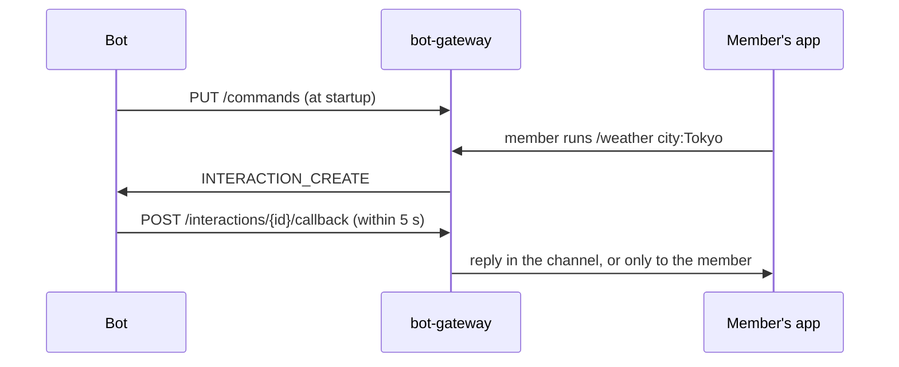

# Slash commands

A bot registers commands; members of a server the bot is installed in pick them from the `/` list in the composer, fill in the options, and the bot receives an `INTERACTION_CREATE` event over the [gateway](/build/gateway). The bot answers through the REST API, publicly or so that only the member who ran the command sees it.

Commands and interactions borrow Discord's shapes: the command object, option types, interaction type 2, callback types 4 and 5 and flag 64. Routes, IDs and permissions are Harmony's; see [Differences from Discord](#differences-from-discord).

## How it works



1. The bot registers its commands with [`PUT /commands`](#register-commands), usually every time it starts.
2. A member types `/` in a server channel or thread. The app lists the bot's commands where the member may use them (see [Where commands are offered](#where-commands-are-offered)).
3. The member picks one, fills in the options and sends. The app shows them "You used /weather · Weatherbot is thinking…", visible to nobody else.
4. The gateway delivers [`INTERACTION_CREATE`](/build/gateway#interaction-create) to every open connection of that bot, and only that bot.
5. Within 5 seconds the bot [answers or defers](#respond). After a defer it has 15 minutes to post the answer and follow-ups.

A bot that is not connected cannot receive the interaction; the member sees "Weatherbot is offline." Interactions are not sent to [outgoing webhooks](/build/outgoing-webhooks) and are not replayed after a reconnect.

## Register commands

| Method | Path | Body | Returns |
|---|---|---|---|
| `GET` | `/commands` | | `200`, the bot's commands |
| `PUT` | `/commands` | Array of commands | `200`, the stored commands |
| `POST` | `/commands` | One command | `201` when new, `200` when it replaced one of the same name |
| `DELETE` | `/commands/{command.id}` | | `204`; `404 Unknown command` |

`PUT /commands` replaces the bot's whole set. A command whose name is kept keeps its ID; names absent from the array are deleted. Calling it with the same array changes nothing, so a bot can send its full list at every start. Commands are global to the bot: the same set is offered in every server it is installed in, and a change applies at once.

```bash
curl -X PUT "https://<instance>/bot-gateway/api/v1/commands" \
  -H "Authorization: Bot $HARMONY_BOT_TOKEN" \
  -H "Content-Type: application/json" \
  -d '[{
    "name": "weather",
    "description": "Current weather for a city",
    "options": [
      { "type": 3, "name": "city", "description": "City name", "required": true, "max_length": 80 },
      { "type": 3, "name": "units", "description": "Units", "choices": [
        { "name": "Celsius", "value": "c" }, { "name": "Fahrenheit", "value": "f" } ] }
    ]
  }]'
```

### Command object

| Field | Type | Description |
|---|---|---|
| `id` | UUID | Set by the server. |
| `name` | string | 1 to 32 characters: letters, digits, `-` and `_`, in any script (`天気` is valid). Lowercase where the script has case. Unique per bot. |
| `description` | string | 1 to 100 characters. Shown under the name in the `/` list. |
| `options` | array | Up to 25 [options](#option-object). |
| `required_permissions` | string[] | Harmony [permission names](/build/permissions-rate-limits#permission-bits) a member needs, all of them, in the channel. Empty or absent: every member who can send there. The server owner and members holding `ADMINISTRATOR` pass every check. |
| `created_at`, `updated_at` | ISO 8601 | Set by the server. |

A bot has at most 100 commands. `default_member_permissions` is refused with `400`: Discord's bit numbers name other permissions in Harmony (Discord's administrator bit is Harmony's `MANAGE_ROLES`), so a value copied from a Discord bot would gate the wrong permission.

### Option object

| Field | Type | Description |
|---|---|---|
| `type` | integer | See [Option types](#option-types). |
| `name` | string | Same rules as a command name; unique among its siblings. |
| `description` | string | 1 to 100 characters. |
| `required` | boolean | Default `false`. Required options come before optional ones. |
| `choices` | array | Up to 25 `{ "name", "value" }`, for types 3, 4 and 10. `name` is 1 to 100 characters; `value` has the option's type. The member picks one. |
| `min_value`, `max_value` | number | Types 4 and 10. |
| `min_length`, `max_length` | integer | Type 3, 0 to 6000. |
| `options` | array | Types 1 and 2 only: the subcommand's options, or the group's subcommands. |

### Option types

| Type | Name | Value the bot receives | The member picks |
|---|---|---|---|
| 1 | `SUB_COMMAND` | Nested `options` | Listed as its own entry, `/bridge clone-server` |
| 2 | `SUB_COMMAND_GROUP` | Nested subcommand | Listed as `/group subcommand` |
| 3 | `STRING` | string | Text, or one of `choices` |
| 4 | `INTEGER` | integer | A whole number, or one of `choices` |
| 5 | `BOOLEAN` | boolean | True or false |
| 6 | `USER` | profile UUID | A member of the server |
| 7 | `CHANNEL` | channel UUID | A channel of the server the member can view |
| 8 | `ROLE` | role UUID | A role of the server |
| 10 | `NUMBER` | number | A number, or one of `choices` |

Not supported: 9 `MENTIONABLE`, 11 `ATTACHMENT`, `autocomplete`, context-menu commands and per-server commands. A command with subcommands takes no value options at its top level; a group holds only subcommands; a subcommand holds no subcommands.

## Where commands are offered

A member sees a bot's command in the `/` list, and may run it, when all of these hold:

- The channel is a text channel of a server hosted on this instance. Direct messages and copies of servers hosted on another instance have no bot commands.
- The channel is not end-to-end encrypted: option values reach the bot as plain text.
- The bot is active and has an active installation in the server, and it can post in the channel: [channel access](/build/permissions-rate-limits#channel-access) for `send_messages`.
- The member can view the channel and send messages in it (`SEND_MESSAGES_IN_THREADS` in a thread), holds every `required_permissions` entry there, and is not timed out. A locked thread offers no commands.

Running a command also counts against the member's limits: the channel's slowmode (unless they hold `MANAGE_MESSAGES`), and 5 commands per 10 seconds per account across the instance.

## Receive an interaction

The gateway sends `INTERACTION_CREATE` with the interaction object; see [Gateway](/build/gateway#interaction-create) for every field.

```json
{
  "op": 0,
  "t": "INTERACTION_CREATE",
  "d": {
    "id": "6f0c2a10-…",
    "type": 2,
    "server_id": "1e7d…",
    "channel_id": "c2d4f8a0-…",
    "thread_id": null,
    "user": { "id": "8a1f3b77-…", "username": "alice", "display_name": "Alice", "bot": false },
    "member": { "nickname": null, "roles": ["5b9e…"], "permissions": ["VIEW_CHANNEL", "SEND_MESSAGES"] },
    "data": {
      "id": "0d3c…",
      "name": "weather",
      "type": 1,
      "options": [{ "name": "city", "type": 3, "value": "Tokyo" }]
    },
    "created_at": "2026-11-10T12:00:00.000Z",
    "respond_by": "2026-11-10T12:00:05.000Z",
    "expires_at": "2026-11-10T12:15:00.000Z"
  }
}
```

For a subcommand, `data.name` is the command's name and `data.options` holds one entry of type 1 (or a type 2 group holding one type 1) whose `options` are the values: `/bridge clone-server dry_run:true` arrives as `{ "name": "bridge", "options": [{ "name": "clone-server", "type": 1, "options": [{ "name": "dry_run", "type": 5, "value": true }] }] }`.

`data.resolved` describes the users, members, channels and roles the options name. A channel the bot cannot view is described by `id` and `type` only.

## Respond

| Method | Path | Within | Body |
|---|---|---|---|
| `POST` | `/interactions/{interaction.id}/callback` | 5 seconds, once | `{ "type": 4, "data": { … } }` answers; `{ "type": 5, "data": { "flags": 64 } }` defers |
| `PATCH` | `/interactions/{interaction.id}/response` | 15 minutes | `{ "content", "embeds" }`: edits the answer, or posts it after a defer |
| `POST` | `/interactions/{interaction.id}/followups` | 15 minutes | `{ "content", "embeds", "flags" }`: one more reply, up to 10 |

`data` takes `content` and `embeds` as in [Create message](/build/rest#create-message), plus `flags`:

| `flags` | Reply |
|---|---|
| `0` or absent | A message in the channel (or thread) from the bot, seen by everyone, headed "Alice used /weather" in the Harmony app. |
| `64` | Seen only by the member who ran the command, marked "Only you can see this". It is not stored as a message: it disappears when the member reloads, and the server deletes it a day later. |

The flag of the callback decides for the answer, including the answer posted after a defer. Each follow-up carries its own flag. Callback answers `204`; the other two answer `200` with the [message object](/build/rest#message-object), or `{ "id", "ephemeral": true, "content", "content_raw" }` for a reply only the member sees.

Public replies are checked like any message the bot posts: the bot needs [`send_messages` and channel access](/build/permissions-rate-limits#channel-access), the instance's length limit applies, and the server's AutoMod judges the reply as the member's own message, so a command cannot post words or links the member could not. A refused reply ends the interaction and the member sees why.

Without a callback within 5 seconds the member sees "Weatherbot did not respond." and a late callback answers `400 Interaction expired`. A bot that needs longer defers first.

| Status | `error` | Cause |
|---|---|---|
| `400` | `Interaction already acknowledged` | A second callback, for example from another connection of the bot. Only the first counts. |
| `400` | `Interaction expired` | Past 5 seconds for the callback, or 15 minutes for the other routes. |
| `400` | `Interaction not acknowledged` | `PATCH` or a follow-up before any callback. |
| `400` | `Follow-up limit reached` | An 11th follow-up. |
| `400` | `Message text exceeds the instance limit of … characters` | |
| `403` | Channel access errors | See [Errors](/build/rest#errors). |
| `404` | `Unknown interaction` | Another bot's interaction, or one deleted a day after it expired. |
| `409` | `Response in progress` | A `PATCH` while the deferred answer is being posted. |

## Example

The [quickstart](/build/bot-quickstart) bot with a `/ping` command in place of `!ping`, using its `api` helper. In the `READY` branch, register the set:

```js
api('PUT', '/commands', [{ name: 'ping', description: 'Check that the bot answers' }])
  .catch((err) => console.error(err.message))
```

And beside the `MESSAGE_CREATE` branch, answer the interaction:

```js
if (t === 'INTERACTION_CREATE' && d.data.name === 'ping') {
  try {
    await api('POST', `/interactions/${d.id}/callback`, {
      type: 4,
      data: { content: 'Pong!', flags: 64 },
    })
  } catch (err) {
    console.error(err.message)
  }
}
```

Type `/ping` in a channel of the server and send: the bot answers "Pong!", seen only by you.

## Differences from Discord

| Discord | Harmony |
|---|---|
| `/applications/{app.id}/commands`, guild commands | `/commands`, global to the bot |
| `default_member_permissions`, Discord bits | `required_permissions`, Harmony permission names |
| Interaction token; `/webhooks/{app.id}/{token}/…` | The bot token; `/interactions/{id}/response` and `/followups` |
| 3 seconds to answer | 5 seconds |
| HTTP interactions endpoint | Gateway only |
| Autocomplete, attachments, mentionables, components, modals, context menus | Not available |
| Snowflake IDs | UUIDs |
