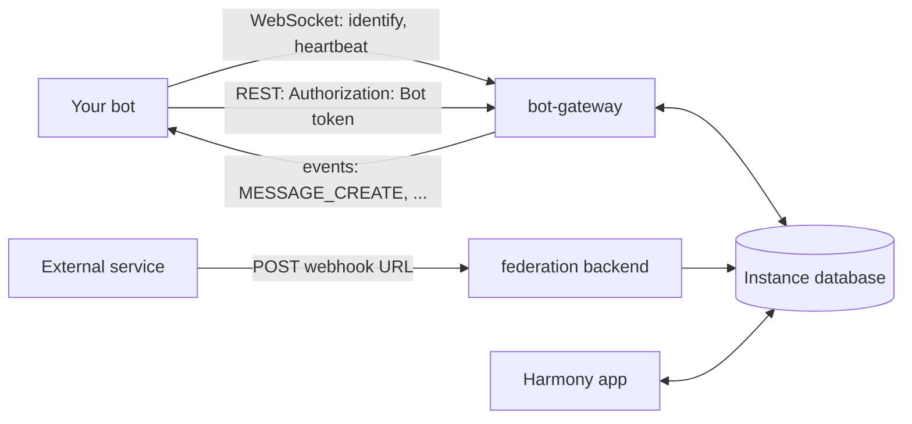

# Build on Harmony

This section is for developers who write bots, integrations and bridges against a Harmony instance. It covers the bot gateway (events over WebSocket), the bot REST API (actions), incoming channel webhooks, and the Bridge v2 API that Discord bridges use.

## What you can build

| You want to | Use | Authenticates with |
|---|---|---|
| React to messages, run commands, moderate, sync structure | A **bot**: the gateway for events, the REST API for actions | The bot's token, `Authorization: Bot <token>` |
| Post messages from another service (CI, GitHub, monitoring) without writing a bot | A **channel webhook**: one HTTP POST per message | The secret in the webhook's URL |
| Relay a channel between Harmony and Discord | A **bridge**: a bot of type Bridge plus the Bridge v2 API | The bridge bot's token |

A bot is an account your code controls. Any user can create bots under **User settings** → **My bots**; a server owner, or a member with Manage Server, adds a bot to a server and chooses what it may do there. A webhook belongs to one channel and posts plain text under the webhook's name. Creating webhooks is covered in [Webhooks](/run/webhooks) for server owners.

## How the pieces connect

The `bot-gateway` service serves the gateway, the REST API and the Bridge v2 API. The federation backend serves webhook URLs. Both write to the instance's database, and the gateway turns new rows into events.



- **Events.** A bot opens one WebSocket, identifies with its token, and receives an event for each message, edit, delete and reaction in the channels it may read. The gateway reads these changes from the database every one to two seconds. Events missed while a bot is disconnected are not replayed. See [Gateway](/build/gateway).
- **Actions.** Everything a bot does (send, edit, react, create channels and roles) is a REST request with the same token. See [REST API](/build/rest).
- **Permissions.** Each server stores a set of permission flags for each bot it runs, and an optional list of channels. The gateway checks them on every request and before delivering each event. See [Permissions and rate limits](/build/permissions-rate-limits).
- **Webhooks.** A webhook URL accepts a Discord-style execute-webhook body and posts it as text. No gateway connection and no bot token are involved. See [Webhooks API](/build/webhooks).

The protocol borrows Discord's shapes where they fit: opcodes 0, 1, 2 and 11, the `Bot` authorization scheme, and Discord's execute-webhook body. It is not Discord-compatible. There is no HELLO, RESUME, sequence number or intent; the heartbeat interval arrives in READY; IDs are UUIDs; routes, payloads and pagination differ. Discord client libraries do not work unmodified.

## Base URLs

The instance's reverse proxy (Caddy or nginx) forwards everything under `/bot-gateway/` to the gateway with that prefix removed, and `/webhooks/channels/` to the federation backend.

| What | URL |
|---|---|
| Gateway (WebSocket) | `wss://<instance>/bot-gateway/gateway` |
| REST API base | `https://<instance>/bot-gateway/api/v1` |
| Bridge v2 API base | `https://<instance>/bot-gateway/bridge/v2` |
| Gateway health check | `https://<instance>/bot-gateway/health` |
| Channel webhook | `https://<instance>/webhooks/channels/<webhook id>/<token>` |

`<instance>` is the host that serves the Harmony web app, for example `har.mony.lol` for the flagship instance. A bot's page under **User settings** → **My bots** shows the **Gateway URL** and **REST base URL** for the instance you are signed in to.

Without a reverse proxy, as in local development, the gateway listens on port 3002: `ws://localhost:3002/gateway` and `http://localhost:3002/api/v1`.

The bot gateway is optional on a self-hosted instance. If `https://<instance>/bot-gateway/health` does not answer with `"status": "ok"`, the operator has not enabled bots; see [Self-host](/self-host/).

```bash
curl https://<instance>/bot-gateway/health
```

```json
{ "status": "ok", "uptime": 5321.4, "timestamp": "2026-10-13T09:00:00.000Z" }
```

## Pages in this section

| Page | Kind | Covers |
|---|---|---|
| [Bot quickstart](/build/bot-quickstart) | Tutorial | Create a bot, add it to a server, receive a message and reply, in one Node file |
| [Gateway](/build/gateway) | Reference | Connection, opcodes, identify, heartbeat, close codes, event delivery, every event payload |
| [REST API](/build/rest) | Reference | Every route, request and response bodies, errors, pagination |
| [Webhooks API](/build/webhooks) | Reference | Executing a channel webhook, GitHub deliveries, limits and errors |
| [Permissions and rate limits](/build/permissions-rate-limits) | Reference | How a bot's permissions are computed, what each route needs, rate limits |
| [Writing a bridge](/build/bridges) | Explanation and reference | Bridge v2 API, relayed authors, message, thread and emoji mapping |
