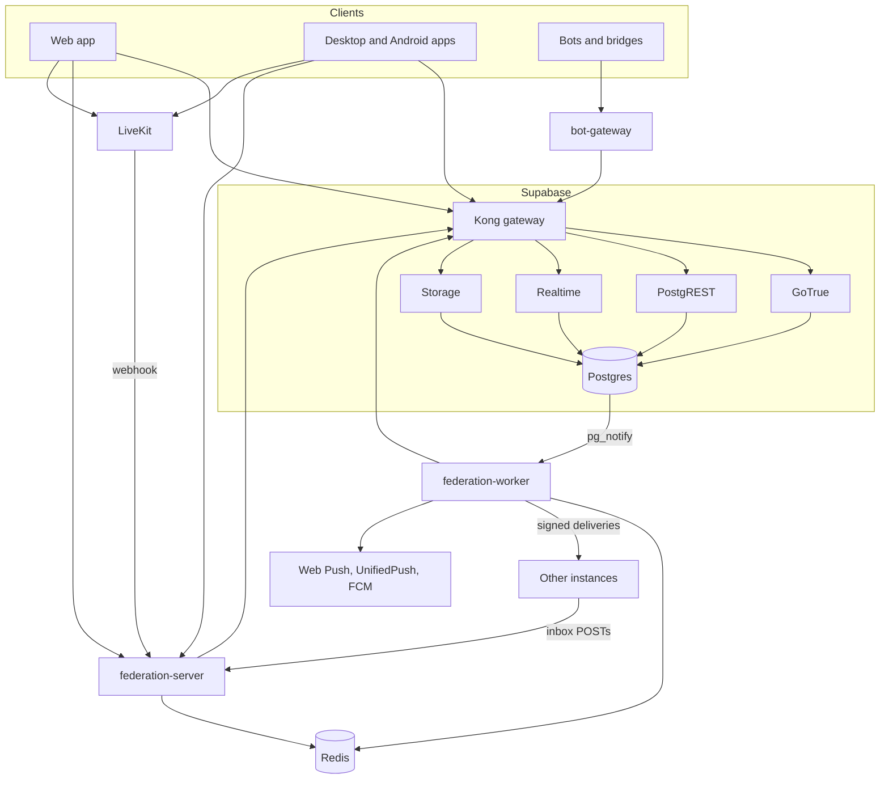
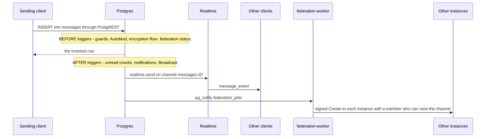

# Architecture

This page explains how Harmony's parts fit together, for people changing the code. It covers the services in a deployment, the path of a chat message from one client to the others and to other instances, where frontend code lives, how end-to-end encryption is layered on top, how two-factor authentication is enforced, and the database conventions every change has to respect. For how an operator runs these services, see [Self-host](/self-host/).

## Services in a deployment

Harmony is a Vue web app on top of Supabase, plus Node services of its own: the federation backend, run as a server and a worker, and the bot gateway. Clients read and write most data straight through Supabase, under row level security; the Node services handle what needs a server: ActivityPub, push, voice tokens and bots.

| Component | Code | Role |
| --- | --- | --- |
| Web app | [`src/`](https://github.com/y4my4my4m/harmony/tree/master/src) | Vue 3, TypeScript, Pinia and Vite. Talks to Supabase with the signed-in user's session. |
| Desktop app | [`src-tauri/`](https://github.com/y4my4my4m/harmony/tree/master/src-tauri) | Tauri 3 shell around the web app: the system webview on Windows and macOS, Chromium Embedded Framework on Linux. Updates itself through `tauri-plugin-updater`. |
| Android app | [`src-tauri/gen/android/`](https://github.com/y4my4my4m/harmony/tree/master/src-tauri/gen/android), [`src-tauri/crates/tauri-plugin-harmony-push/`](https://github.com/y4my4my4m/harmony/tree/master/src-tauri/crates/tauri-plugin-harmony-push) | The same shell on Android, with push through FCM or UnifiedPush. |
| Postgres | [`db_schema/migrations/`](https://github.com/y4my4my4m/harmony/tree/master/db_schema/migrations) | All data and most of the logic: tables, row level security policies, functions and triggers. |
| PostgREST | Supabase | HTTP API over the `public` schema: tables, and functions as RPC endpoints. |
| GoTrue | Supabase | Accounts, sessions, OAuth sign-in and two-factor authentication; issues the JWTs that row level security reads. |
| Realtime | Supabase | WebSocket delivery of the Broadcast messages that triggers send with `realtime.send`. Message views use no `postgres_changes`; `messages` stays in the `supabase_realtime` publication for clients older than 1.8.6 and the legacy federation listener (`USE_BULLMQ_QUEUE=false`). |
| Storage | Supabase | Uploaded files; imgproxy transforms images. |
| federation-server | [`federation-backend/`](https://github.com/y4my4my4m/harmony/tree/master/federation-backend), `FEDERATION_MODE=server` | ActivityPub endpoints (WebFinger, NodeInfo, actors, inboxes, outboxes), push subscriptions, link previews, the GIF proxy, LiveKit tokens and webhook, presence and typing, signed media URLs, channel webhooks. |
| federation-worker | `federation-backend/`, `FEDERATION_MODE=worker` | BullMQ workers fed by `LISTEN federation_jobs`, outbound delivery with retries, push sending, maintenance jobs, voice participant reconciliation. |
| Redis | | BullMQ queues, cache, presence and rate limits. |
| bot-gateway | [`bot-gateway/`](https://github.com/y4my4my4m/harmony/tree/master/bot-gateway) | REST API and WebSocket gateway (`/gateway`) for bots, and the Bridge v2 API for bridges. Polls the database for new messages, edits and reactions and dispatches them to connected bots. |
| LiveKit | [`webrtc/`](https://github.com/y4my4my4m/harmony/tree/master/webrtc) | SFU for voice channels, calls and screen share. The federation backend signs room tokens; clients connect to LiveKit directly. |
| Bull Board | [`bull-board/`](https://github.com/y4my4my4m/harmony/tree/master/bull-board) | Optional dashboard for the BullMQ queues. |

The federation server, worker and bot gateway reach Postgres through PostgREST with the service role key, which bypasses row level security. The worker also holds one direct Postgres connection for `LISTEN` (`FEDERATION_LISTENER_URL`). The Discord bridge is a separate program in [its own repository](https://github.com/y4my4my4m/harmony-discord-bridge) that talks to the bot gateway.

## How a channel message travels

A message is a row in `public.messages`. Everything after the insert is driven by triggers on that table.

1. **Send.** The composer calls the chat store ([`src/stores/useChat.ts`](https://github.com/y4my4my4m/harmony/blob/master/src/stores/useChat.ts)), which shows an optimistic copy and calls `services.messages.sendChannelMessage`. That delegates to [`src/services/core/CoreMessageService.ts`](https://github.com/y4my4my4m/harmony/blob/master/src/services/core/CoreMessageService.ts), which checks length and attachment limits, encrypts the content when the channel requires it, and inserts the row with `supabase.from('messages').insert(...)`.
2. **Checks in the database.** Row level security decides whether the sender may post. `BEFORE INSERT` triggers enforce message length, slowmode, the channel's encryption setting (`trg_enforce_channel_encryption`) and AutoMod (`trg_moderate_message`). AutoMod can drop the row, in which case the insert returns no rows and the client reports the block.
3. **Fan-out to local clients.** `AFTER INSERT` triggers update unread counts, create notifications and call `broadcast_message_event()`, which sends the row with `realtime.send` to the private Broadcast topic `channel-messages-<channel id>` (`dm-conversation-<conversation id>` for DMs), and a thread reply also to `thread-messages-<thread id>`. Clients subscribed to that topic receive it as `message_event`; the store's handlers key on the message id, so a row already applied from the insert response is applied once. On reconnect the store fetches messages newer than the last one it holds. A new notification row queues a `send-push-notification` job, which the worker sends through Web Push, UnifiedPush or FCM.
4. **Federation.** `trigger_queue_channel_message_federation()` runs `BEFORE INSERT`. It marks the message `skipped` when the author is not local, the message already came from another instance (`metadata.federated`), or the channel is encrypted. Otherwise it marks it `queued` and calls `queue_federation_job('federate-channel-message', ...)`, which publishes the job on `pg_notify('federation_jobs')`. The notification is delivered when the transaction commits.
5. **Delivery.** In the worker, `NotificationListener` turns the notification into a BullMQ job, and [`ChannelMessageHandler.ts`](https://github.com/y4my4my4m/harmony/blob/master/federation-backend/src/listeners/ChannelMessageHandler.ts) builds the ActivityPub `Create`:
   - When the server is hosted on another instance, the activity goes to that server's inbox, and the hosting instance fans it out.
   - When the server is local and federation is enabled for it, the activity goes to every instance that has a member who can view the channel. With no such member, the message is marked `skipped`.

   `DeliveryQueue` signs each request with HTTP Signatures, refuses private and blocked destinations, and retries failures that a retry can fix.
6. **Arrival at another instance.** The receiving instance's federation server takes the `Create` at `POST /servers/<server id>/inbox`, verifies the signature, checks that the actor may write to the channel, and inserts the message with `metadata.federated` set. Its own broadcast trigger then delivers the row to its clients, and its federation trigger skips it.

Direct messages follow the same path through `trigger_federate_dm`, the `federate-dm` job and the `dm-conversation-<id>` topic. The [Federation](/federation/) section describes the ActivityPub objects themselves.

## Frontend structure

| Path | Contents |
| --- | --- |
| [`src/main.ts`](https://github.com/y4my4my4m/harmony/blob/master/src/main.ts), [`src/App.vue`](https://github.com/y4my4my4m/harmony/blob/master/src/App.vue) | App start-up: Pinia, router, i18n, service worker, instance picker for native apps |
| [`src/router/index.ts`](https://github.com/y4my4my4m/harmony/blob/master/src/router/index.ts) | Routes |
| [`src/layouts/`](https://github.com/y4my4my4m/harmony/tree/master/src/layouts) | `BaseLayout`, `ChatLayout`, `SocialLayout`, `AuthLayout` |
| [`src/views/`](https://github.com/y4my4my4m/harmony/tree/master/src/views) | Route-level pages: chat, DMs, timeline, profiles, server settings, user settings, admin panel |
| [`src/components/`](https://github.com/y4my4my4m/harmony/tree/master/src/components) | Components, grouped by feature in subdirectories (`chat/`, `dm/`, `voice/`, `settings/`, `moderation/`, `encryption/`, `threads/`, `activitypub/` and others) |
| [`src/stores/`](https://github.com/y4my4my4m/harmony/tree/master/src/stores) | Pinia stores: `chat` (channel messages), `dm`, `serverChannel`, `serverUsers`, `auth`, `unifiedVoiceChannel`, `activitypub`, `notification` and others. [`src/stores/shared/`](https://github.com/y4my4my4m/harmony/tree/master/src/stores/shared) holds the helpers they share: optimistic messages, the realtime message envelope, the reaction engine. |
| [`src/services/`](https://github.com/y4my4my4m/harmony/tree/master/src/services) | Data access and side effects. `core/` holds the database operations for messages, posts, profiles and interactions; `encryption/`, `federation/` and `voice/` hold those subsystems. [`RealtimeConnectionManager.ts`](https://github.com/y4my4my4m/harmony/blob/master/src/services/RealtimeConnectionManager.ts) wraps realtime subscriptions with a registry, reconnection with backoff, and a reconnect callback that stores use to fetch what they missed. |
| [`src/composables/`](https://github.com/y4my4my4m/harmony/tree/master/src/composables) | Reusable composition functions: keybinds, permissions, push, unread counts, layout state |
| [`src/utils/`](https://github.com/y4my4my4m/harmony/tree/master/src/utils) | Helpers without component state: markdown parsing and rendering, sanitising, mention grammar, search queries |
| [`src/locales/`](https://github.com/y4my4my4m/harmony/tree/master/src/locales) | UI strings in English, German, Spanish, French, Japanese, Korean and Chinese; [`src/i18n.ts`](https://github.com/y4my4my4m/harmony/blob/master/src/i18n.ts) loads the active one on demand |
| [`src/supabase.ts`](https://github.com/y4my4my4m/harmony/blob/master/src/supabase.ts) | The Supabase client. Its URL and key come from the stored instance (native apps), `/config.json` ([`runtimeConfig.ts`](https://github.com/y4my4my4m/harmony/blob/master/src/services/runtimeConfig.ts)), or the build's `VITE_*` variables. |
| [`src/utils/userScopedStorage.ts`](https://github.com/y4my4my4m/harmony/blob/master/src/utils/userScopedStorage.ts) | `localStorage` namespaced per user and instance, so switching accounts does not leak state |

Most data access goes from components through stores and composables to services, which call Supabase or the federation backend; some components and views also query Supabase directly. Encryption services are imported lazily, which keeps their crypto code out of the initial bundle.

## Backend services

The federation backend is one Express and TypeScript codebase that runs as two processes:

| Path | Contents |
| --- | --- |
| [`src/index.ts`](https://github.com/y4my4my4m/harmony/blob/master/federation-backend/src/index.ts) | Entry point; `FEDERATION_MODE` selects `server`, `worker` or `unified` (both) |
| [`src/server.ts`](https://github.com/y4my4my4m/harmony/blob/master/federation-backend/src/server.ts), [`src/worker.ts`](https://github.com/y4my4my4m/harmony/blob/master/federation-backend/src/worker.ts) | The HTTP server and the queue worker |
| [`src/activitypub/`](https://github.com/y4my4my4m/harmony/tree/master/federation-backend/src/activitypub) | Actors, inboxes, outboxes, HTTP Signatures, delivery, converters between ActivityPub objects and rows |
| [`src/queue/`](https://github.com/y4my4my4m/harmony/tree/master/federation-backend/src/queue) | `BullMQManager` (one queue per job type), `NotificationListener` (the `LISTEN` bridge) and one handler per job type |
| [`src/listeners/`](https://github.com/y4my4my4m/harmony/tree/master/federation-backend/src/listeners) | Federation logic the queue handlers call, per kind of object |
| [`src/routes/`](https://github.com/y4my4my4m/harmony/tree/master/federation-backend/src/routes) | Non-ActivityPub HTTP routes: push, link previews, GIFs, LiveKit, voice, presence, media, account migration |
| [`src/services/`](https://github.com/y4my4my4m/harmony/tree/master/federation-backend/src/services) | Redis, push senders, LiveKit, link previews, server discovery, presence, typing |

The bot gateway ([`bot-gateway/src/`](https://github.com/y4my4my4m/harmony/tree/master/bot-gateway/src)) keeps its REST routes in `api/`, the WebSocket gateway and event dispatcher in `gateway/`, and token checks and bot permissions in `auth/`. The [Build](/build/) section documents its API.

## End-to-end encryption

Encryption happens in the client; the database stores ciphertext in `messages.content` with `encrypted`, `encryption_metadata` and `megolm_session_id` beside it. The code is in [`src/services/encryption/`](https://github.com/y4my4my4m/harmony/tree/master/src/services/encryption). [Privacy and security](/use/privacy-security) describes what users see.

- **Group sessions.** Each channel or conversation has Megolm-style sessions: one ratcheting session key per room, rotated periodically and when membership changes (the server-maintained room epoch). The implementation is Harmony's own, built on WebCrypto (AES-GCM and HKDF); it is not wire-compatible with Matrix.
- **Recovery key.** A BIP39 recovery phrase encrypts the backup of session keys that the server stores in `megolm_key_backups`; the server never sees the phrase. Restoring on a new device needs the phrase or a device pairing.
- **Devices.** Each device has an ECDSA P-256 signing key in IndexedDB, with the public key in `user_devices`. Encrypted messages carry a signature that recipients verify against the sender's published key before decrypting. Device pairing over a QR code hands a new device the account's keys through `device_approval_requests`.
- **Channels and servers.** A server's encryption policy and each channel's own settings resolve to an effective state in the database (`effective_channel_encryption`, `channel_messages_encrypted`); the database rejects plaintext in an encrypted channel. Encrypted channel content is the ciphertext plus plaintext mention parts, so the server can still notify mentioned users. Messages in encrypted channels are not federated.
- **Direct messages.** `conversation_encryption_settings.encryption_enabled` marks a conversation encrypted; the database rejects a plaintext message there unless the sender consented to a plaintext send (`metadata.plaintext_override.authorized`, written after the client's fallback prompt). Server-side writers (federation backend, bot gateway) are exempt. A change is announced to every participant as `conversation:encryption` on their user channel.
- **Voice.** In a channel with voice encryption, LiveKit's `ExternalE2EEKeyProvider` encrypts every media frame. One participant mints a random room key and distributes it over the Megolm channel; the SFU forwards frames it cannot read.

## Two-factor enforcement

Two-factor authentication uses GoTrue's TOTP factors. GoTrue issues an `aal1` token for a correct password before the TOTP challenge; once a factor is verified, the session is `aal2`. GoTrue v2.182.1 keeps a verified session at `aal2` and deletes the account's other `aal1` sessions on every successful verify, so a legitimate session of an enrolled account is `aal2`, and an `aal1` one is mid-challenge. The rules live in [`20261005400001_account_security.sql`](https://github.com/y4my4my4m/harmony/blob/master/db_schema/migrations/20261005400001_account_security.sql) and [`20261007500001_sign_out_scope.sql`](https://github.com/y4my4my4m/harmony/blob/master/db_schema/migrations/20261007500001_sign_out_scope.sql); the pgTAP files `55_account_security.sql` and `79_sign_out_scope.sql` test them.

**In the database.** `public.session_meets_aal()` is false for an `authenticated` token that is not `aal2` when the account has a verified factor in `auth.mfa_factors`, and for a token whose `session_id` no longer exists in `auth.sessions`. Three places apply it:

- `public.enforce_request_assurance()` runs before every PostgREST request (`pgrst.db_pre_request`, set on the `authenticator` role). It answers 401 `session_revoked` for a signed-out session and 403 `insufficient_aal` when the assurance check fails. Only `/rpc/redeem_recovery_code_and_disable_mfa` stays open below `aal2`. Every PostgREST request fails while the setting names a missing function, so renaming or dropping the function needs the setting changed first.
- Restrictive policies on `public.messages` (`SELECT`, which `postgres_changes` reads), `realtime.messages` (private Broadcast topics) and `storage.objects` cover the paths that do not go through a PostgREST request.
- `sign_out_my_sessions` and `revoke_my_session` check it themselves, independent of the pre-request hook. GoTrue's `/logout` accepts any valid token, so the reverse proxy passes only `?scope=local` to it (`self-host/Caddyfile`, `dev/nginx-auth-logout.template.conf`); signing out other sessions goes through these functions.

**In the client.** `validateSessionForMFA` in [`src/stores/auth.ts`](https://github.com/y4my4my4m/harmony/blob/master/src/stores/auth.ts) decides whether a tab adopts a stored session:

| Session | Result |
| --- | --- |
| `aal2` | Accepted |
| `aal1`, with `totp` in the token's `amr` claim | Accepted |
| `aal1`, the account has no verified TOTP factor | Accepted |
| `aal1`, no `totp` in `amr`, the account has a verified factor | Rejected: signed out and sent to the challenge |
| `aal1`, no `totp` in `amr`, the factor lookup fails | Rejected |

The database makes no exception for `amr`: it refuses any `aal1` token of an enrolled account. When PostgREST answers `session_revoked` or `insufficient_aal`, `src/supabase.ts` reports it and `handleSessionRejected` drops the local session and returns to `/login`, except while a sign-in challenge or password reset is in progress.

**Step-up.** Some operations need a recent second factor, not only an `aal2` session. `public.session_step_up_fresh(method, max_age)` checks the `amr` claim for a method authenticated within `max_age`.

| Operation | Requirement |
| --- | --- |
| `generate_mfa_recovery_codes()` | `aal2` and a TOTP verification within 10 minutes, else `step_up_required` |
| `delete_my_account(p_password)`, `begin_account_move(...)` | Enrolled accounts: `aal2` and a TOTP verification within 10 minutes, else `mfa_required`. Then the password for accounts that have one, or any sign-in within 10 minutes for accounts that do not |
| `sign_out_my_sessions`, `revoke_my_session`, `save_recovery_codes` | `aal2` when the account has a verified factor |

[Privacy and security](/use/privacy-security) covers two-factor authentication from the user's side.

## Database design

The schema is the backend. Clients call PostgREST directly with the user's JWT, so the database itself is the access control layer.

- **Row level security.** Policies decide what each role reads and writes. They resolve the caller with `profiles.auth_user_id = auth.uid()`, through `public.get_current_profile_id()`. The app creates local profiles whose id equals the auth user id, but the pgTAP and end-to-end fixtures give them different ids, so a policy that compares the wrong column fails a test.
- **`SECURITY DEFINER` functions.** A definer function runs as its owner and bypasses row level security. Each one sets an explicit `search_path`, and because no policy applies inside it, it checks the caller itself. Internal definers, such as `queue_federation_job`, are executable by `service_role` and the function owners only.
- **Grants.** Supabase's default privileges grant `EXECUTE` on every new function in `public` to `anon` and `authenticated`, so a new function is an unauthenticated HTTP endpoint until a migration revokes that. Some live instances have no default privileges in `public` at all, so new tables also need explicit grants. [Database migrations](/contribute/migrations#grant-access-to-new-functions-and-tables) shows the pattern.
- **Realtime authorization.** Private Broadcast topics are authorized by a policy on `realtime.messages` that calls `public.can_subscribe_to_topic(topic)`. It denies any topic it does not recognise, so a new topic needs a branch there.
- **Inventories.** Three generated files describe the published surface, and CI fails when they are stale:

| File | Contents |
| --- | --- |
| [`db_schema/SURFACE.tsv`](https://github.com/y4my4my4m/harmony/blob/master/db_schema/SURFACE.tsv) | Every function PostgREST publishes: arguments, return type, `definer` or `invoker`, `search_path`, the roles granted `EXECUTE`, and how it is reached |
| [`db_schema/REACHABILITY.tsv`](https://github.com/y4my4my4m/harmony/blob/master/db_schema/REACHABILITY.tsv) | How execution enters each function: an RPC call site in the code, a trigger, a policy, a view, a cron job, or another function. `http anon` and `service key` mark functions nothing in the repository reaches that PostgREST publishes anyway; `nothing` marks dead code. |
| [`db_schema/PUBLISHED-NO-CALLER.tsv`](https://github.com/y4my4my4m/harmony/blob/master/db_schema/PUBLISHED-NO-CALLER.tsv) | The reviewed list of published functions with no caller in the repository |

[Database migrations](/contribute/migrations) covers how to change the schema and regenerate these files.
