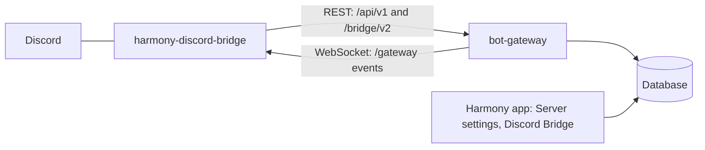

# Hosting Discord bridges

This page is for instance operators. It covers what your instance does for the Discord bridge, how to run the bridge host service, how to offer your instance's own Discord bot and hosting of communities' own bots, and which bridge and Harmony versions go together. Server owners setting up a bridge read [Discord bridge](/run/discord-bridge); developers writing their own bridge read [Writing a bridge](/build/bridges).

## How bridges reach your instance

The bridge is a separate program, [harmony-discord-bridge](https://github.com/y4my4my4m/harmony-discord-bridge), published as the image `ghcr.io/y4my4my4m/harmony-discord-bridge`. Every bridge connects to Discord as a Discord bot and to your instance through the bot gateway, as an ordinary Harmony bot of type bridge:



Communities choose between three modes in **Server settings** → **Discord Bridge**. Each needs something different from you:

| Mode | Who runs the bridge | Discord bot | What you provide |
|---|---|---|---|
| Run it yourself (`self`) | The community, on its own computer | The community's | The bot gateway, reachable at `https://<domain>/bot-gateway` |
| Own bot, run on this instance (`hosted`) | Your bridge host | The community's; you hold its token | The bridge host, and hosting turned on |
| This instance's bot (`instance`) | Your bridge host | Yours, shared by every community that links it | The bridge host, and a Discord application set up in the admin panel |

A community's choice, channel pairs and options live in the database (`discord_bridges`, `discord_bridge_channels`). The bot gateway hands each bridge its configuration over `/bridge/v2`, and the bridge reports its state back every 30 seconds; the app's bridge page shows that state.

### Gateway routes the bridge uses

All routes sit under `https://<domain>/bot-gateway`, which Caddy forwards to the bot gateway with the prefix removed.

| Route | Caller | Authentication |
|---|---|---|
| `POST /bridge/v2/redeem` | A self-run bridge on first start: setup code for credentials | The setup code |
| `GET /bridge/v2/hosted` | The bridge host: own-bot hosted bridges with their tokens | `X-Bridge-Host-Secret` |
| `GET /bridge/v2/hosted/instance` | The bridge host: the instance bot's token and its linked bridges | `X-Bridge-Host-Secret` |
| `GET /bridge/v2/discord/authorize`, `GET /bridge/v2/discord/callback` | The community's browser during **Add to Discord** | A one-time link state |
| `GET /bridge/v2/config`, `POST /bridge/v2/status`, `POST /bridge/v2/pairs`, `DELETE /bridge/v2/pairs/:discordChannelId` | Each running bridge | `Authorization: Bot <token>` |
| `/api/v1/...` and the WebSocket at `/gateway` | Each running bridge, for messages, reactions, threads and events | `Authorization: Bot <token>` |

When a community changes pairs or options, the gateway notices within `BRIDGE_CONFIG_POLL_MS` (default 5 s) and sends the connected bridge a `BRIDGE_CONFIG_UPDATE` event; a bridge also refetches its configuration every 60 s. [Writing a bridge](/build/bridges) documents the routes in full.

## Turn on bridge hosting

Self-run bridges need only the bot gateway. Hosted bridges and the instance's bot also need the bridge host service.

1. Run `harmony config` and answer yes to the bot gateway and to hosting Discord bridges. Scripted, in `self-host/`:

   ```bash
   HARMONY_BOTS=y HARMONY_DISCORD=y bash configure.sh --non-interactive
   docker compose up -d
   ```

   Hosting turns bots on if they are off.
2. `configure.sh` generates a 64-character `BRIDGE_HOST_SECRET`, writes it to both `self-host/bot-gateway.env` and `self-host/discord-bridge.env`, sets `ENABLE_DISCORD_BRIDGE=true` and adds the `discord` profile to `COMPOSE_PROFILES`. The `discord-bridge-host` service (container `harmony-discord-bridge-host`) starts.
3. Run `harmony doctor`. Its `discord` check fails when the two secrets differ or are shorter than 32 characters, and when `discord-bridge-host` is not running.

The service only runs bridges. Communities see the hosted option and the instance bot only after you turn them on in the admin panel, below.

Hosted bridges and the instance bot keep Discord tokens in Supabase Vault (the `supabase_vault` extension, present in the Supabase Postgres image the installer uses). Without Vault, both are unavailable and their setup calls fail.

`bot-gateway.env` must carry `INSTANCE_DOMAIN`, the public domain of the Harmony app; `configure.sh` sets it. The gateway builds from it the addresses it hands to bridges (`https://<domain>`, `https://<domain>/bot-gateway`, `wss://<domain>/bot-gateway/gateway`) and the instance bot's OAuth2 redirect.

## Let communities bring their own bot

1. Open **User settings** → **Instance admin**, the **Config** tab, **General**.
2. Under **Discord bridge** → **Let communities bring their own bot**, turn on **Run communities' own bots**. The switch saves at once.
3. Set **Maximum hosted bridges** (default 25) and click **Save limit**.

Server owners then see **Use your own bot, run on this instance**. They paste their Discord bot token; the database stores it in Vault, and the bridge host picks the bridge up on its next poll, within a minute.

- Once the limit is reached, new hosted bridges are refused; existing ones keep running.
- Turning the switch off stops every hosted bridge at the host's next poll and refuses new ones.
- You hold each community's token, and a token reads every Discord channel its bot can see. The app tells communities so before they choose.

## Set up this instance's Discord bot

One public Discord application, owned by you, serves every community that links it. Communities add it to their Discord server with **Add to Discord**, without creating a bot. The bridge host (bridge 2.1.0 or later) runs it on one Discord connection for all linked servers.

The steps are also on the admin page, under **Set up the bot in the Discord Developer Portal**.

1. In the [Discord Developer Portal](https://discord.com/developers/applications), click **New Application**, name it (communities see this name in Discord) and click **Create**.
2. On **General Information**, copy the **Application ID**.
3. Open **Bot**. Switch on **Public Bot** and **Requires OAuth2 Code Grant**. With the code grant on, the bot joins a Discord server only when a community links it from Harmony.
4. Under **Privileged Gateway Intents**, switch on **Message Content Intent** and **Server Members Intent**; switch on **Presence Intent** only if you turn on presence sync below. Click **Save Changes**.
5. Click **Reset Token**, then **Copy**: this is the bot token.
6. Open **OAuth2**. Under **Redirects**, click **Add Redirect**, paste the **Redirect address** the admin page shows, and save. It has the form `https://<domain>/bot-gateway/bridge/v2/discord/callback` and has to match exactly.
7. Still in **OAuth2**, click **Reset Secret** under **Client Secret** and copy it.
8. In **User settings** → **Instance admin** → **Config** → **General** → **Discord bridge** → **This instance's Discord bot**, fill in **Application ID**, **Client secret** and **Bot token**, and click **Save credentials**.
9. Turn on **Offer this bot to communities**.

The secrets go to Vault and are never shown again; the fields then read **Stored**, and leaving a field empty keeps the stored value. **Remove bot** deletes the credentials and turns the bot off: linked communities stop bridging until a bot is set up again, and their bridges and pairs stay.

Server owners then see **Use *instance*'s bot** first, marked **Recommended**, in **Server settings** → **Discord Bridge**.

| Setting | Default | Effect |
|---|---|---|
| **Offer this bot to communities** | off | Shows the option to server owners; available once the three credentials are saved. Off stops every instance bridge at the host's next poll |
| **Presence sync** | off | Lets linked communities sync Discord presence. Turn it on only while the Presence Intent is on in the Developer Portal |
| **Maximum linked Discord servers** | 100 | New links are refused at this count; **Save limit** saves it |

The redirect address the admin page shows comes from the app's own address; the gateway builds the one it sends to Discord from `INSTANCE_DOMAIN`. If the two differ, Discord rejects the authorization. While neither `INSTANCE_DOMAIN` nor `PUBLIC_URL` is set in `bot-gateway.env`, the authorize and callback routes answer 503.

### How the instance bot behaves

- **One connection.** The bridge host logs in once for every linked Discord server and routes events by server. The Server Members intent is requested while any linked community syncs its member list, the Presence intent only while **Presence sync** is on and a community syncs presence. A change in that set reconnects the bot once for everyone; communities linking or leaving do not.
- **Linking.** **Add to Discord** creates a one-time link state valid for 15 minutes. The gateway checks it before sending the community to Discord, exchanges Discord's authorization code with your client secret, and links the Discord server from Discord's token response. A Discord server can be linked to one Harmony server at a time.
- **Leaving.** When a community disconnects or links another Discord server, the bot leaves the old one after it has stayed unlinked for 10 minutes. It leaves nothing while the gateway cannot be reached. A link refused after Discord already added the bot makes it leave that server at once, unless another instance bridge links it.
- **Permissions.** **Add to Discord** asks for permission integer `309774904384`: the own-bot set plus Use External Emojis (see [Discord permissions](/run/discord-bridge#discord-permissions)). Communities linked before a permission was added lack it until they add the bot again: **Manage Messages** (bridge 2.2.0) for deleting Discord members' messages removed on Harmony, **Create Public Threads** and **Send Messages in Threads** (bridge 2.4.0) for threads.
- **Custom emoji.** Harmony custom emoji are uploaded as application emoji of the instance's Discord application and shared by every community, in one map at `/data/app-emojis/<application id>.json` in the bridge host's volume. Discord allows 2000 per application; the bridge keeps at most 1900 and removes the least recently used.
- **Verification.** Discord limits an unverified bot to 100 servers. Before that, apply for verification in the Developer Portal (App Verification) and request the Message Content and Server Members intents, and Presence if you use presence sync. Discord rarely grants Presence.

You run the bot, so you can read every Discord channel a community gives it access to. The app tells communities so before they choose it.

## The bridge host service

One container runs every hosted bridge and every instance bridge. Every 60 seconds it reads `GET /bridge/v2/hosted` and `GET /bridge/v2/hosted/instance`: new bridges start, removed ones stop, changed tokens restart. Each hosted bridge has its own Discord connection; instance bridges share one. One bridge failing does not affect the others.

The compose service sets:

| Variable | Value in `docker-compose.yml` |
|---|---|
| `BRIDGE_MODE` | `host` |
| `HARMONY_URL` | `http://bot-gateway:3002`: the gateway on the compose network |
| `HARMONY_PUBLIC_URL` | `https://${DOMAIN}`: the public Harmony address, used in the links, mentions and avatars the bridge posts to Discord |
| `BRIDGE_HOST_SECRET` | From `discord-bridge.env` |

The image tag is `${DISCORD_BRIDGE_VERSION:-2}`, and the volume `discord-bridge-data` is mounted at `/data`.

All variables the bridge program reads in host mode:

| Variable | Required | Meaning |
|---|---|---|
| `BRIDGE_MODE` | yes | `host` |
| `HARMONY_URL` | yes | The bot gateway directly (`http://bot-gateway:3002`), or the public Harmony address; the bridge finds the gateway at `<url>/bot-gateway` or at `<url>` itself |
| `BRIDGE_HOST_SECRET` | yes | Equal to the gateway's `BRIDGE_HOST_SECRET` |
| `HARMONY_PUBLIC_URL` | when `HARMONY_URL` points at the gateway directly | The public Harmony address |
| `HARMONY_MEDIA_ORIGIN` | no | Origin to download Harmony files from instead of the public address, for files whose address has the public Harmony origin |
| `MAX_UPLOAD_MB` | no | Harmony files up to this size per message are uploaded to Discord, larger ones posted as links; default `8`, `0` posts every file as a link |
| `DATA_DIR` | no | State directory; `/data` in the image |
| `LOG_LEVEL` | no | `error`, `warn`, `info` (default) or `debug`; only `debug` logs message contents |
| `HEALTH_PORT` | no | Port of the `/health` endpoint, default `8080`; `off` disables it |

Extra variables for the compose service go in `self-host/discord-bridge.env`; `configure.sh` rewrites only `BRIDGE_HOST_SECRET` there and keeps other keys.

The volume holds per-bridge state under `/data/hosted/<bridge id>` and `/data/instance/<bridge id>`, and the instance bot's emoji map under `/data/app-emojis`.

### Run the host on another machine

The bridge host can run on any machine that reaches your instance. Set `BRIDGE_MODE=host`, `HARMONY_URL=https://<domain>` and the same `BRIDGE_HOST_SECRET` as `bot-gateway.env`, mount a volume at `/data`, and do not start the `discord-bridge-host` service on the instance as well, or every bridge runs twice.

### Check the host

```bash
harmony logs discord-bridge-host
```

| Log line | Meaning |
|---|---|
| `Host mode: bot-gateway <url>` | The host found the gateway |
| `Own-bot hosting is disabled on this Harmony instance (or BRIDGE_HOST_SECRET is not set there); no own-bot hosted bridges run.` | **Run communities' own bots** is off, or the gateway's secret is missing or shorter than 32 characters |
| `Instance bot enabled: N linked bridge(s).` | The instance bot is on and configured |
| `Instance bot disabled on this Harmony instance; stopping its bridges.` | **Offer this bot to communities** was turned off, or the credentials were removed |
| `Hosted bridge <id> starting`, `... removed; stopping`, `... tokens changed; restarting` | Reconciliation of hosted bridges |
| `Left Discord server <name> (<id>): no instance bridge has linked it for 10 min.` | The instance bot left an unlinked Discord server |

Inside the container, `http://127.0.0.1:8080/health` answers 200 while both lists load and lists every bridge with its state; the image's health check uses it. A wrong secret makes the gateway answer 401, and 30 refused secrets from one address in 15 minutes lock that address out for the rest of the window.

## Bot gateway settings

The bridge-related keys of `self-host/bot-gateway.env`; [Configuration](/self-host/configuration) lists the rest.

| Variable | Default | Meaning |
|---|---|---|
| `INSTANCE_DOMAIN` | set by `configure.sh` | Public domain of the Harmony app; base of the addresses handed to bridges and of the instance bot's OAuth2 redirect |
| `BRIDGE_HOST_SECRET` | set by `configure.sh` with hosting on | Shared secret of the bridge host. Shorter than 32 characters, the two `hosted` routes answer 404 |
| `BRIDGE_CONFIG_POLL_MS` | `5000` | How often the gateway checks bridges' configuration for changes, in ms, clamped to 1000-60000 |

The gateway limits these routes per client address, as it sees it through `TRUST_PROXY`:

| Route | Limit |
|---|---|
| `POST /bridge/v2/redeem` | 10 attempts per 15 minutes |
| `GET /bridge/v2/hosted`, `GET /bridge/v2/hosted/instance` | 30 refused secrets per 15 minutes |
| `GET /bridge/v2/discord/authorize` and `/callback` together | 30 requests per 15 minutes |

## Attachments from Discord

Discord's file links expire. **User settings** → **Instance admin** → **Config** → **General** → **Bridge attachments** → **Attachment handling** sets what the bot gateway does with Discord file links in messages bots post, for the whole instance; click **Save changes**.

| Option | Behaviour |
|---|---|
| **Link only** (default) | Stores the Discord link; it stops working when it expires |
| **Refresh on demand** | When someone views a bridged message whose link expired, the gateway asks the owning bridge, which must be connected, to re-sign the links and update the message. No disk use |
| **Mirror to storage** | Copies each file into the instance's message storage when the message arrives. Permanent; uses disk. A file over 50 MB, or one that fails to download, keeps its Discord link |

## Versions

The bridge image versions separately from Harmony. Each release is published as `X.Y.Z`, `X.Y`, `X` and `latest`, for linux/amd64 and linux/arm64. The compose file uses the major tag `2`, so `harmony update` pulls the newest 2.x bridge along with Harmony, applies the migrations, then recreates the gateway and the bridge host. To hold the bridge at a version, set `DISCORD_BRIDGE_VERSION` in `self-host/.env` to a published tag such as `2.4`.

Some bridge features need a Harmony release with the matching gateway routes and migrations. Update Harmony before, or together with, the bridge host:

| Bridge | Harmony | Feature |
|---|---|---|
| 2.1.0 | | Host mode runs the instance's Discord bot |
| 2.2.0 | | A Discord member's message deleted on Harmony is deleted on Discord; the bot needs **Manage Messages** |
| 2.3.0 | 1.6.25 | `/bridge import-emojis` |
| 2.4.0 | 1.7.5 | Threads cross the bridge; the bot needs **Create Public Threads** and **Send Messages in Threads** |
| 2.4.1 | 1.7.6 | The "started a thread" notice names the Discord member who started the thread |

When a release needs a new Discord permission, communities whose bot was added earlier have to add it again: **Add to Discord again** for the instance bot, **Invite the bot to your Discord server** for their own bot. Communities that run the bridge themselves update their own container; the bridge page shows each bridge's **Bridge version**.
