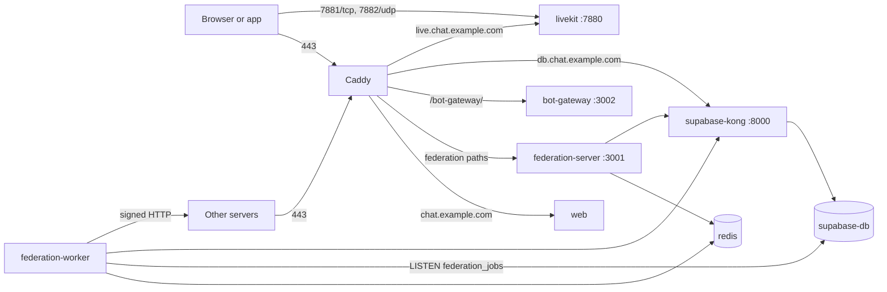

# Self-host Harmony

This section is for people who run their own Harmony instance: chat servers,
DMs, voice and video, a social feed that federates with Mastodon and other
Harmony instances, bots and Discord bridges, on a server you control. This
page describes what an instance consists of and what it needs; the
[install guide](/self-host/install) sets one up with one command.

## What an instance runs

An instance is one Docker Compose project, `harmony`, defined in
`self-host/docker-compose.yml`. Harmony's own services run prebuilt images
from `ghcr.io/y4my4my4m`; Supabase (Postgres, sign-in, the data API,
realtime and file storage) comes from the upstream Supabase Docker stack,
pulled in with `include:` and adjusted by `self-host/supabase-overrides.yml`.

| Service | Container | Runs | Role |
|---|---|---|---|
| `caddy` | `harmony-caddy` | always | HTTPS and routing for the instance's three host names; the only service that publishes 80/tcp, 443/tcp and 443/udp |
| `web` | `harmony-web` | always | The web app, served by nginx. Writes `/config.json` from its environment at start, so one image serves every instance |
| `federation-server` | `harmony-federation-server` | always | HTTP side of the federation backend (port 3001): ActivityPub inboxes and actors, WebFinger, NodeInfo, invite link cards, link previews, push subscriptions, LiveKit tokens, webhooks |
| `federation-worker` | `harmony-federation-worker` | always | Queue side of the same image: delivery to other servers, push sending, scheduled jobs. Serves no HTTP |
| `redis` | `harmony-redis` | always | Job queue (BullMQ), caching, presence, rate limits, LiveKit state |
| `livekit` | `harmony-livekit` | voice on | Voice and video server; publishes 7881/tcp and 7882/udp for media |
| `bot-gateway` | `harmony-bot-gateway` | bots on | Bot REST API and WebSocket gateway (port 3002), served at `/bot-gateway/` |
| `discord-bridge-host` | `harmony-discord-bridge-host` | Discord bridge hosting on | Runs the Discord bridges communities host on this instance; image `ghcr.io/y4my4my4m/harmony-discord-bridge`, versioned separately (`DISCORD_BRIDGE_VERSION`, default `2`) |

Voice, bots and Discord bridge hosting are Compose profiles (`voice`,
`bots`, `discord`); `COMPOSE_PROFILES` in `self-host/.env` lists the enabled
ones, and the installer and `harmony config` set it.

The Supabase containers:

| Service | Container | Role |
|---|---|---|
| `db` | `supabase-db` | Postgres (`supabase/postgres:15.8.1.060`) |
| `auth` | `supabase-auth` | Sign-in and accounts (GoTrue) |
| `rest` | `supabase-rest` | The data API (PostgREST) |
| `realtime` | `realtime-dev.supabase-realtime` | Live updates to clients over WebSocket |
| `storage` | `supabase-storage` | Uploaded files: avatars, attachments, emoji |
| `imgproxy` | `supabase-imgproxy` | Image resizing |
| `kong` | `supabase-kong` | The API gateway Caddy serves at the `db.` name |
| `meta`, `studio` | `supabase-meta`, `supabase-studio` | Supabase Studio, a database browser |
| `analytics`, `vector` | `supabase-analytics`, `supabase-vector` | Supabase's log collection |

Supabase's Edge Functions and Supavisor stay defined but never start: the
federation backend replaces the first, and the second would publish Postgres
on the host.

`self-host/configure.sh` pins the upstream Supabase stack to one commit (the
last that runs `supabase/postgres:15.8.1.060`, the image Harmony's CI installs
the schema on). [Update the Supabase stack](/self-host/update-backup#update-the-supabase-stack)
covers moving to a newer pin.

## Host names

An instance answers on three names under one domain. With
`chat.example.com` as the domain:

| Name | Serves |
|---|---|
| `chat.example.com` | The web app, the federation endpoints, and the bot gateway under `/bot-gateway/` |
| `db.chat.example.com` | The Supabase API through Kong: sign-in, data, realtime, uploads; Supabase Studio at its root |
| `live.chat.example.com` | LiveKit signalling; only with voice on |

The browser talks to Supabase at `db.` and to everything else at the
domain itself. Database triggers queue federation and push jobs; the worker
picks them up and delivers activities to other servers.

The domain is part of every handle (`@you@chat.example.com`) and every
ActivityPub id the instance publishes. Other servers keep those ids, so the
domain is chosen once.

## What you need

| | Requirement |
|---|---|
| Operating system | Linux on x86_64 (amd64) or arm64 (aarch64): a VPS, a home server or a VM. Prebuilt images exist for these two; elsewhere `HARMONY_BUILD=1` builds Harmony's images on the server, provided Supabase's images run there |
| Memory | 2 GB. The installer and `harmony doctor` warn below about 1.9 GB. Under 4 GB without swap, the installer offers a 2 GB swap file and `harmony doctor` warns |
| Disk | The installer stops with under 4 GB free (the images alone take about 4 GB) and warns under 10 GB; the database, uploads and backups grow from there |
| Access | Root over SSH, so the installer can install Docker, create `/opt/harmony` and link `/usr/local/bin/harmony`. A user in the `docker` group can install into a directory of its own with `HARMONY_DIR` |
| Network | A public IPv4 address, for an instance others can reach. A [LAN install](/self-host/install#install-on-a-lan) works without one |
| Domain | A domain name you can add DNS records to; see [DNS records](/self-host/install#dns) |
| Email (optional) | An SMTP service, so Harmony can send password resets and address confirmations; see [Email](/self-host/email) |

The installer installs or checks the software itself: Docker Engine with the
Compose plugin 2.24.4 or later (from `https://get.docker.com`, with your
consent), plus `git`, `curl` and `openssl` through the package manager. Node
and Python are not needed on the host.

### Ports

| Port | For |
|---|---|
| 80/tcp, 443/tcp | HTTPS, and Let's Encrypt validation |
| 443/udp | HTTP/3 (optional) |
| 7881/tcp, 7882/udp | Voice and video media, with voice on |

Everything else stays on Docker's internal network.

## The database never faces the internet

The stack publishes only Caddy's ports and, with voice on, LiveKit's media
ports. Postgres, Kong, Logflare and Redis are reachable only from other
containers. Keep it that way: automated attacks scan the internet for
exposed Postgres, and a known one plants an event trigger that creates a
superuser the next time an administrator changes the schema.

Ports published by Docker bypass `ufw` and `firewalld` rules: a published
port is open even when the firewall says otherwise. `harmony doctor` checks
that none of Postgres (5432), Supavisor (6543), the Supabase CLI's Postgres
(54322), Kong (8000, 8443), Logflare (4000) or Redis (6379) is published or
reachable on the server's public address, and looks for the traces of that
attack. [Security checks](/self-host/troubleshooting#security) explains what a
failure means.

`configure.sh` generates every secret at random on a new install: the
database password, the JWT secret and the API keys signed with it, the
Studio password, Redis, LiveKit, the Web Push keys. None of Supabase's
example values survive an install.

## Where things live

Everything belongs to the checkout, `/opt/harmony` by default. The files
that make up an instance, under `/opt/harmony/self-host/`:

| Path | Holds |
|---|---|
| `.env` | Domain, TLS mode, enabled services, image tag, registration policy, ports |
| `federation.env` | Federation backend: Supabase keys, Redis, push (VAPID) and LiveKit keys |
| `bot-gateway.env` | Bot gateway, with bots on |
| `discord-bridge.env` | Discord bridge host secret, with Discord bridge hosting on |
| `livekit.yaml` | LiveKit, with voice on |
| `supabase/.env` | Supabase: database password, JWT secret, SMTP, sign-up and OAuth settings |
| `supabase/volumes/db/data` | The database |
| `supabase/volumes/storage` | Uploaded files |
| `backups/` | Backups and restore logs |

The `.env` files and `livekit.yaml` hold the only copy of the instance's
secrets; `harmony backup` saves them with the database.
[Configuration](/self-host/configuration) describes their keys.

Supabase Studio is at `https://db.chat.example.com`: user `supabase`,
password `DASHBOARD_PASSWORD` from `supabase/.env`.

## Ways to install

- **The installer** (the supported path): one command on a blank Linux
  server checks the host, asks a few questions, checks DNS, starts the stack,
  loads the database and creates the admin account. The `harmony` command
  then updates, backs up, restores and checks the instance.
  [Install](/self-host/install).
- **The same stack by hand**: run the steps the installer runs, or put Caddy
  behind a reverse proxy you already have. The root `docker-compose.prod.yml`
  and `docker-compose.full.yml` serve setups that bring their own Supabase
  and nginx. [Docker Compose and reverse proxies](/self-host/docker-compose).

## Pages in this section

- [Install](/self-host/install): DNS, the installer, its questions, scripted
  and LAN installs, the admin account and registration.
- [Update, backup, restore](/self-host/update-backup): `harmony update`,
  versions, backups and their schedule, restoring and moving servers.
- [Configuration reference](/self-host/configuration): the configuration
  files and their keys.
- [Email (SMTP)](/self-host/email), [OAuth sign-in](/self-host/oauth),
  [Voice and video](/self-host/voice), [Push notifications](/self-host/push),
  [Discord bridges](/self-host/discord-bridges): optional features.
- [The harmony command](/self-host/cli): every subcommand and flag, and every
  check `harmony doctor` runs.
- [Monitoring](/self-host/monitoring): watching an instance.
- [Docker Compose and reverse proxies](/self-host/docker-compose): running
  without the installer, and what a proxy in front must do.
- [Troubleshooting](/self-host/troubleshooting): error messages and symptoms,
  with causes and fixes.
