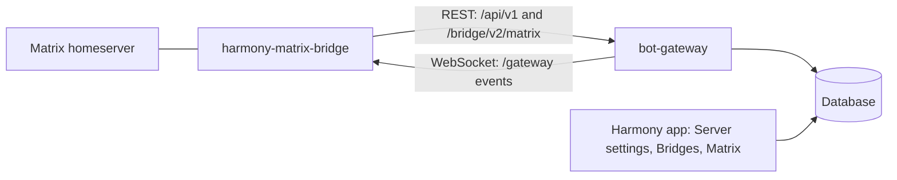

# Hosting Matrix bridges

This page is for instance operators. It covers what your instance does for Matrix bridges, how to run the bridge service, how to offer your instance's own bridge and to run communities' own accounts, and what each gives you access to. Server owners setting up a bridge read [Matrix bridge](/run/matrix-bridge); developers writing their own bridge read [Writing a bridge](/build/bridges).

## How bridges reach your instance

The bridge is a separate program, [harmony-matrix-bridge](https://github.com/y4my4my4m/harmony-matrix-bridge), published as the image `ghcr.io/y4my4my4m/harmony-matrix-bridge`. Every bridge connects to a Matrix homeserver, and to your instance through the bot gateway as a Harmony bot:



Communities choose in **Server settings** → **Bridges** → **Matrix**. Each way needs something different from you:

| Way | Who runs the bridge | Matrix side | What you provide |
|---|---|---|---|
| This instance's bridge (`instance`) | Your bridge service | Yours: an application service on a homeserver, or one account, shared by every community | The bridge service, and a bridge set up in the admin panel |
| Own account, run on this instance (`hosted`) | Your bridge service | The community's account; you hold its access token | The bridge service, and hosting turned on |
| Run it yourself (`self`) | The community, on its own computer | The community's | The bot gateway, reachable at `https://<domain>/bot-gateway` |
| Their own bridge program | The community | Whatever the program uses | The bot gateway |

You need no Matrix homeserver for hosted bridges. For the instance's bridge, an account on any homeserver is enough; a homeserver of your own lets Harmony members appear in Matrix as Matrix users of their own.

A community's choice and its channel pairs live in the database (`matrix_bridges`, `bridge_channels`). The bot gateway hands each bridge its configuration over `/bridge/v2/matrix`, and the bridge reports its state back every 30 seconds; the app shows that state.

## Turn on bridge hosting

Bridges people run themselves need only the bot gateway. Hosted bridges and the instance's bridge also need the bridge service.

1. Run `harmony bridges add matrix`, or answer `matrix` or `both` to the installer's bridge question. It turns the bot gateway on if it is off, and needs no terminal. `harmony bridges` shows what runs, and [`harmony bridges remove matrix`](/self-host/cli#harmony-bridges) stops it.
2. `configure.sh` generates a 64-character secret, writes it to `self-host/bot-gateway.env` as `MATRIX_BRIDGE_HOST_SECRET` and to `self-host/matrix-bridge.env` as `BRIDGE_HOST_SECRET`, sets `ENABLE_MATRIX_BRIDGE=true` and adds the `matrix` profile to `COMPOSE_PROFILES`. The `matrix-bridge-host` service (container `harmony-matrix-bridge-host`) starts. The secret is not the Discord bridge's: each service reads the tokens of its own platform alone.
3. Run `harmony doctor`. Its `matrix` check fails when the two secrets differ or are shorter than 32 characters, and when `matrix-bridge-host` is not running.

The service only runs bridges. Communities see the two options after you turn them on in **User settings** → **Instance admin** → **Config** → **General** → **Matrix bridge**. **Bridge service** there shows when the service was last heard from, its version and what keeps it from working; while it is absent it shows the command that starts it.

Tokens are kept in Supabase Vault (the `supabase_vault` extension, present in the Supabase Postgres image the installer uses). Without Vault, both options are unavailable and their setup calls fail.

## Let communities bring their own account

1. Under **Matrix bridge** → **Let communities bring their own account**, turn on **Run communities' own accounts**. The switch saves at once.
2. Set the maximum number of hosted bridges (default 25) and click **Save limit**.

Server owners then see **Use your own Matrix account, run on this instance**. They sign in to their homeserver in the browser, which sends the password to the homeserver alone, or paste an access token. The database stores the token in Vault, and the service picks the bridge up within a minute.

- Once the limit is reached, new hosted bridges are refused; existing ones keep running.
- Turning the switch off stops every hosted bridge at the service's next poll and refuses new ones. The bridges' data stays in the service's volume.
- You hold each community's access token, and a token gives access to every room its account is in. The app tells communities so before they choose.
- Communities name the homeserver, so the service treats its address as untrusted: https only, no redirects to another host, and no private, loopback, link-local or other non-public address. `MATRIX_ALLOW_PRIVATE_HOMESERVERS=true` in `self-host/matrix-bridge.env` lifts the address rule, for a homeserver on your own network. Anyone who can set up a hosted bridge can then make the service send requests to your network.

## Set up this instance's Matrix bridge

One Matrix connection of yours serves every community. A community gets a code for a channel, invites your bridge's account to a room and posts `!harmony link ML-…` there; the bridge checks that whoever posted it may change the room's settings, and links the room.

Open **Matrix bridge** → **This instance's Matrix bridge** and choose the connection.

### An ordinary account

Every Harmony message comes from the account, with the member's name in front.

1. Make an account for the bridge on any homeserver.
2. Get a token that does not expire: **Get a token that doesn't expire** on the page shows the command. It asks for the user name and the password and prints the token.
3. Fill in the **Homeserver address** and the **Access token**, and click **Save bridge**.
4. Turn on **Offer this bridge to communities**.

### An application service on your own homeserver

Harmony members can appear in Matrix as Matrix users of their own. You need to administer the homeserver.

1. Fill in the **Homeserver address** (the address Matrix apps connect to), the **Server name** (the part after the colon in its user IDs), and, if the defaults do not fit, the **Name of the bridge's account** (default `harmony_relay`) and the **Address of the bridge** (default `https://<domain>/matrix-appservice`). Click **Save bridge**.
2. Click **Make the registration file**. The file downloads once and holds the bridge's keys to the homeserver. A lost file is replaced with **Make a new registration file**, which changes the keys.
3. Put the file on the homeserver. On Synapse, add its path to `app_service_config_files` in `homeserver.yaml` and restart Synapse.
4. Turn on **Offer this bridge to communities**.

The homeserver calls the bridge at the **Address of the bridge**. The default goes through Caddy, which passes `/matrix-appservice/_matrix/app/` to the service and nothing else. A homeserver on the same Docker network can call `http://matrix-bridge-host:9009` instead. Behind another reverse proxy, forward `/matrix-appservice/` with the rest.

Changing the server name, the account's name or the address of the bridge makes the registration on the homeserver out of date: make a new file and replace it there. Changing the homeserver address forgets the stored tokens, so that another host never receives them: enter the new homeserver's access token with it, or make a new registration file.

### Settings

| Setting | Default | Effect |
|---|---|---|
| **Offer this bridge to communities** | off | Shows **Use *instance*'s bridge** first, marked **Recommended**, in **Server settings** → **Bridges** → **Matrix**; available once the bridge is set up. Off stops every instance bridge at the service's next poll |
| **Maximum servers** | 100 | New ones are refused once this many servers chose the bridge, linked or not |

The tokens go to Vault and are never shown again; the fields then read **Stored**, and leaving a field empty keeps the stored value. **Remove bridge** deletes the tokens and turns the bridge off: communities stop bridging until a bridge is set up again, and their bridges and pairs stay.

### How the instance's bridge behaves

- **One connection.** The service holds one Matrix connection for every community and passes each room's messages to the bridge of the server that paired it.
- **Linking.** A code is valid for 30 minutes, works once and belongs to one channel. It stops working when the manager who got it no longer manages the server. A code moves a room that another server had linked: the room's own administrators decide where it goes.
- **Invitations.** The account accepts an invitation, at most 50 rooms without a code at a time, and leaves again when no code is posted within 10 minutes. It declines an encrypted room. It leaves a room within about a minute after its pair is removed, and the rooms of a disconnected bridge after 10 minutes. With an ordinary account, a code counts only in rooms the account was invited to while the service ran.
- **Turned off.** While the switch is off the application service answers 503; the homeserver delivers what happened meanwhile once it is on again, as after downtime.
- **Members' Matrix users.** Harmony members appear under names of the account's own (`@harmony_relay_h_…`), one per member and shared by every server. A public room takes them as they are; in another room the account needs the right to invite. Changing the server name or the account's name starts new ones, and communities invite the new account.
- **Encryption.** End-to-end encrypted rooms and channels are not bridged.
- **Consent.** Harmony members who opted out in **Bridge privacy** are not relayed, and have no Matrix user in the rooms of that server. Matrix people opt out with `!bridge-privacy opt-out` ([Matrix bridge](/run/matrix-bridge)).

You run the bridge, so you can read every room a community links. The app tells communities so before they choose it.

## The bridge service

One container runs every hosted bridge and the instance's bridge. Every 60 seconds it reads `GET /bridge/v2/matrix/host`: new bridges start, removed ones stop, changed tokens restart that bridge. One bridge failing does not affect the others.

The compose service sets:

| Variable | Value in `docker-compose.yml` |
|---|---|
| `BRIDGE_MODE` | `host` |
| `HARMONY_URL` | `http://bot-gateway:3002`: the gateway on the compose network |
| `HARMONY_PUBLIC_URL` | `https://${DOMAIN}`: the public Harmony address |
| `BRIDGE_HOST_SECRET` | From `matrix-bridge.env` |

The image tag is `${MATRIX_BRIDGE_VERSION:-1}`, and the volume `matrix-bridge-data` is mounted at `/data`. Extra variables go in `self-host/matrix-bridge.env`; `configure.sh` rewrites only `BRIDGE_HOST_SECRET` there and keeps other keys.

All variables the bridge program reads in host mode:

| Variable | Required | Meaning |
|---|---|---|
| `BRIDGE_MODE` | yes | `host` |
| `HARMONY_URL` | yes | The bot gateway, `http://bot-gateway:3002` |
| `BRIDGE_HOST_SECRET` | yes | Equal to the gateway's `MATRIX_BRIDGE_HOST_SECRET`, at least 32 characters |
| `HARMONY_PUBLIC_URL` | no | The instance's public address, for what people are told in rooms |
| `MATRIX_ALLOW_PRIVATE_HOMESERVERS` | no | Default `false`; `true` lets communities name homeservers on private addresses |
| `LISTEN_HOST`, `LISTEN_PORT` | no | `0.0.0.0` and `9009`: `/health`, and the application service a homeserver calls |
| `DATA_DIR` | no | State directory; `/data` in the image |

Each hosted bridge runs in a worker thread of its own, about 25 MB of memory each; one that throws, loops or exceeds its memory ends alone and starts again. The instance's bridges share one process: an error in one restarts that one. Five hosted bridges and one instance bridge took 146 MB; allow 0.6 GB for 25 hosted ones.

The volume holds what joins the two sides: which Matrix event is which Harmony message, and how far each account has read, under `/data/hosted/<bridge id>` and `/data/instance`. `harmony backup` saves the database, not this volume. Without it, replies to earlier messages cross without what they reply to, and the messages sent in Matrix while the service was away are not copied; the bridge takes its Matrix users over again. The folder of a bridge that is no longer listed stays, because the list cannot say whether it is gone or a switch is off: remove it by hand with the service stopped.

### Check the service

```bash
harmony logs matrix-bridge-host
```

| Log line | Meaning |
|---|---|
| `Bridge list read: 2 hosted, 5 on the instance's connection` | At the start, and after a failure |
| `Harmony refuses BRIDGE_HOST_SECRET: …` | The two secrets differ |
| `Harmony hosts no Matrix bridges: …` | The bot gateway has no secret, or is older than 1.9.9 |
| `Cannot read the bridge list from Harmony; retrying` | The bot gateway does not answer; what runs goes on |
| `[1a2b3c4d] …`, `[instance] …` | One bridge, by the first characters of its id; the instance's connection |
| `… Bridge starting`, `… Credentials changed; restarting`, `… Bridge no longer listed; stopping` | As the instance lists them |
| `… Matrix homeserver connected`, `… Harmony gateway connected`, `… Pair ready` | In working order |
| `… Cannot reach the Matrix homeserver; retrying` | It is down, or its address is not allowed (`MATRIX_ALLOW_PRIVATE_HOMESERVERS`) |
| `… The homeserver refuses the access token. …` | A new token is needed |
| `[instance] The homeserver does not accept the bridge yet: …` | The registration file is not on the homeserver, or an older one is |
| `… Another bridge uses this Matrix account; nothing is relayed` | One account serves one bridge |
| `… Room linked`, `[instance] Left a room …`, `[instance] Declined …` | Linking and leaving |
| `… Messages from Matrix were not copied: …` | The bridge was down, or its queue full, too long |
| `… Bridge stopped by an error; restarting in 5 s. …` | With the place in the program |
| `[instance] Local storage failed; …`, `… could not start: DATA_DIR cannot be written` | Check the disk |

Logs hold no tokens, codes, messages or Matrix ids of people. Inside the container, `http://127.0.0.1:9009/health` answers 200 while the list was read in the last five minutes; the image's health check uses it.

## Bot gateway settings

| Variable | Default | Meaning |
|---|---|---|
| `MATRIX_BRIDGE_HOST_SECRET` | set by `configure.sh` with hosting on | Shared secret of the bridge service. Shorter than 32 characters, the host routes answer 404 |
| `BRIDGE_CONFIG_POLL_MS` | `5000` | How often the gateway checks bridges' configuration for changes, in ms, clamped to 1000-60000 |

## Versions

The bridge image versions separately from Harmony. Each release is published as `X.Y.Z`, `X.Y`, `X` and `latest`, for linux/amd64 and linux/arm64. The compose file uses the major tag `1`, so `harmony update` pulls the newest 1.x bridge along with Harmony, applies the migrations, then recreates the gateway and the bridge service. To hold the bridge at a version, set `MATRIX_BRIDGE_VERSION` in `self-host/.env`.

| Bridge | Harmony | Feature |
|---|---|---|
| 1.0.0 | 1.9.9 | Bridges set up from the app: the instance's bridge, communities' own accounts, setup codes |
| 0.1.0 | 1.9.8 | `config.json` written by hand, for a bridge program of one's own |
