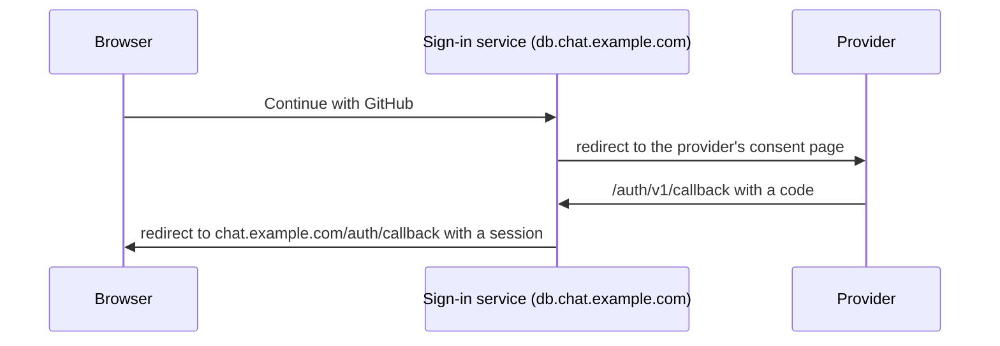

# OAuth sign-in

This page is for operators who want **Continue with Google**,
**Continue with GitHub** or **Continue with Twitch** on their sign-in page.
Those three are the providers the app offers; it has no button for any
other.

Each provider needs two things: credentials in the Supabase sign-in service,
which runs the OAuth exchange, and the provider's button turned on in the
app. Either one alone does nothing useful: a button without credentials
fails, and credentials without a button are never used.

## How a sign-in goes



A person signing in with a provider for the first time gets a new account and
then picks a username, as after a normal registration. Registration set to
`invite` or `closed` (`harmony registration`) stops these new accounts too:
the sign-in service refuses every new account while sign-up is disabled.

## Create the provider application

In the developer console of each provider you want, create an OAuth
application for the instance: an OAuth client of type web application at
Google, an OAuth app at GitHub, an application at Twitch. Give it this
callback (redirect) URL:

```text
https://db.chat.example.com/auth/v1/callback
```

The host is `DB_DOMAIN`, the Supabase API, not the app's domain. The URL is
`API_EXTERNAL_URL` from `self-host/supabase/.env` followed by
`/auth/v1/callback`.

Note the client ID and client secret the provider gives you.

## Add the credentials

In `self-host/supabase/.env`, add three lines per provider:

```bash
GITHUB_ENABLED=true
GITHUB_CLIENT_ID=your-client-id
GITHUB_SECRET=your-client-secret
```

| Provider | Variables |
|---|---|
| Google | `GOOGLE_ENABLED`, `GOOGLE_CLIENT_ID`, `GOOGLE_SECRET` |
| GitHub | `GITHUB_ENABLED`, `GITHUB_CLIENT_ID`, `GITHUB_SECRET` |
| Twitch | `TWITCH_ENABLED`, `TWITCH_CLIENT_ID`, `TWITCH_SECRET` |

Apply them:

```bash
cd /opt/harmony/self-host
docker compose up -d
```

`self-host/supabase-overrides.yml` passes them to the sign-in service as
`GOTRUE_EXTERNAL_GITHUB_ENABLED`, `GOTRUE_EXTERNAL_GITHUB_CLIENT_ID` and
`GOTRUE_EXTERNAL_GITHUB_SECRET` (and likewise for `GOOGLE` and `TWITCH`),
with `GOTRUE_EXTERNAL_<PROVIDER>_REDIRECT_URI` set to
`API_EXTERNAL_URL/auth/v1/callback`. `configure.sh` neither writes nor
removes these keys, so they survive `harmony config` and `harmony update`.

On a manual deployment with your own Supabase stack, set the
`GOTRUE_EXTERNAL_*` variables on its `auth` service directly; the upstream
compose file has no lines for them.

## Show the buttons

Turn the providers on in the admin panel:

1. Open **User settings** → **Instance admin** → **Config** →
   **Authentication**.
2. Switch on **Google**, **Twitch** or **GitHub**.
3. Select **Save OAuth settings**.

The buttons appear on the sign-in and registration pages the next time they
load, in the order Google, Twitch, GitHub.

The app decides which buttons to show in this order:

1. The providers saved in the admin panel (`instance_config.oauth_providers`),
   when at least one is on.
2. Otherwise, `ENABLED_OAUTH_PROVIDERS` in `self-host/.env`, a comma-separated
   list such as `google,github` (`VITE_ENABLED_OAUTH_PROVIDERS` in a static
   build). A change needs `docker compose up -d`.
3. Otherwise, no buttons, and no divider between them and the email form.

Switching every provider off in the admin panel therefore falls back to
`ENABLED_OAUTH_PROVIDERS`. To hide all buttons, leave that variable empty
as well.

## Check it

- Open the sign-in page in a private window and select the provider's
  button. The provider's consent page should open.
- An error page from the provider about the redirect URI means the callback
  URL registered with the provider differs from
  `https://db.chat.example.com/auth/v1/callback`.
- An error after the provider's page sends you back comes from the sign-in
  service: `harmony logs auth` shows it. A provider whose `_ENABLED` key is
  not `true` is refused there.
