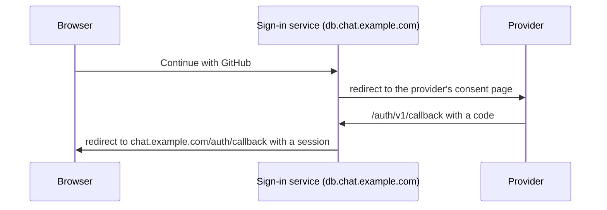

# OAuth sign-in

This page is for operators who want **Continue with Google**,
**Continue with GitHub** or **Continue with Twitch** on their sign-in page,
or a button for an identity provider they run themselves, such as
Authentik, Keycloak or Better Auth. The second case has its own section,
[Your own identity provider](#your-own-identity-provider).

Each provider needs two things: credentials in the Supabase sign-in service,
which runs the OAuth exchange, and the provider's button turned on in the
app. Either one alone does nothing useful: a button without credentials
fails, and credentials without a button are never used.

## How a sign-in goes



A person signing in with a provider for the first time gets a new account and
then picks a username, as after a normal registration. Registration set to
`invite` or `closed` (`harmony registration`) stops these new accounts too:
the sign-in service refuses every new account while sign-up is disabled.

## Create the provider application

In the developer console of each provider you want, create an OAuth
application for the instance: an OAuth client of type web application at
Google, an OAuth app at GitHub, an application at Twitch. Give it this
callback (redirect) URL:

```text
https://db.chat.example.com/auth/v1/callback
```

The host is `DB_DOMAIN`, the Supabase API, not the app's domain. The URL is
`API_EXTERNAL_URL` from `self-host/supabase/.env` followed by
`/auth/v1/callback`.

Note the client ID and client secret the provider gives you.

## Add the credentials

In `self-host/supabase/.env`, add three lines per provider:

```bash
GITHUB_ENABLED=true
GITHUB_CLIENT_ID=your-client-id
GITHUB_SECRET=your-client-secret
```

| Provider | Variables |
|---|---|
| Google | `GOOGLE_ENABLED`, `GOOGLE_CLIENT_ID`, `GOOGLE_SECRET` |
| GitHub | `GITHUB_ENABLED`, `GITHUB_CLIENT_ID`, `GITHUB_SECRET` |
| Twitch | `TWITCH_ENABLED`, `TWITCH_CLIENT_ID`, `TWITCH_SECRET` |

Apply them:

```bash
cd /opt/harmony/self-host
docker compose up -d
```

`self-host/supabase-overrides.yml` passes them to the sign-in service as
`GOTRUE_EXTERNAL_GITHUB_ENABLED`, `GOTRUE_EXTERNAL_GITHUB_CLIENT_ID` and
`GOTRUE_EXTERNAL_GITHUB_SECRET` (and likewise for `GOOGLE` and `TWITCH`),
with `GOTRUE_EXTERNAL_<PROVIDER>_REDIRECT_URI` set to
`API_EXTERNAL_URL/auth/v1/callback`. `configure.sh` neither writes nor
removes these keys, so they survive `harmony config` and `harmony update`.

On a manual deployment with your own Supabase stack, set the
`GOTRUE_EXTERNAL_*` variables on its `auth` service directly; the upstream
compose file has no lines for them.

## Show the buttons

Turn the providers on in the admin panel:

1. Open **User settings** → **Instance admin** → **Config** →
   **Authentication**.
2. Switch on **Google**, **Twitch** or **GitHub**.
3. Select **Save OAuth settings**.

The buttons appear on the sign-in and registration pages the next time they
load, in the order Google, Twitch, GitHub.

The app decides which buttons to show in this order:

1. The providers saved in the admin panel (`instance_config.oauth_providers`),
   when at least one is on.
2. Otherwise, `ENABLED_OAUTH_PROVIDERS` in `self-host/.env`, a comma-separated
   list such as `google,github` (`VITE_ENABLED_OAUTH_PROVIDERS` in a static
   build). A change needs `docker compose up -d`.
3. Otherwise, no buttons, and no divider between them and the email form.

Switching every provider off in the admin panel therefore falls back to
`ENABLED_OAUTH_PROVIDERS`. To hide all buttons, leave that variable empty
as well.

## Check it

- Open the sign-in page in a private window and select the provider's
  button. The provider's consent page should open.
- An error page from the provider about the redirect URI means the callback
  URL registered with the provider differs from
  `https://db.chat.example.com/auth/v1/callback`.
- An error after the provider's page sends you back comes from the sign-in
  service: `harmony logs auth` shows it. A provider whose `_ENABLED` key is
  not `true` is refused there.

## Your own identity provider

Any OpenID Connect (OIDC) provider can sign people in to Harmony, and so can
an OAuth 2.0 provider with a userinfo endpoint. Its button,
**Continue with NAME**, comes after the built-in ones on the sign-in and
registration pages.

The sign-in service (Supabase Auth, GoTrue) runs the exchange. It keeps the
provider's settings and client secret in its own table,
`auth.custom_oauth_providers`, which the API roles cannot read. The app
only knows the provider's id, name and icon, from
`instance_config.custom_oauth_providers`. `harmony auth add-provider` writes
both; the admin panel lists them but cannot change them.

### Requirements

- **Sign-in service 2.196.0.** Harmony's self-host stack runs it from
  Harmony 1.9.1 on (`harmony update`). Custom providers arrived in 2.187.0;
  issuers ending in `/` (Authentik) work from 2.190.0, and key sets that mix
  algorithms from 2.196.0.
- **HTTPS everywhere.** The issuer and every endpoint start with `https://`,
  with a certificate the `auth` container trusts: a public CA, not a
  self-signed one.
- **A public address.** The sign-in service refuses a provider whose host is
  `localhost` or `*.localhost`, or resolves to a loopback, private
  (`10.0.0.0/8`, `172.16.0.0/12`, `192.168.0.0/16`) or link-local address.
  It checks when you add the provider and again at sign-in. A provider on
  the same machine or LAN needs a DNS name that resolves to a public address
  from inside the `auth` container.
- **An asymmetric signing key.** ID tokens signed with RS256, RS384, RS512,
  ES256, ES384, ES512, PS256, PS384, PS512 or EdDSA. HS256, signed with the
  client secret, is refused.
- **An email address**, unless you add the provider with `--email-optional`.

### 1. Register Harmony with the provider

Create an OAuth client (an "application") at the provider:

| Setting | Value |
|---|---|
| Client type | Confidential (web application), with a client secret |
| Redirect URI | `https://db.chat.example.com/auth/v1/callback` |
| Scopes | `openid`, `email`, `profile` |
| Grant | Authorization code; PKCE (S256) allowed |

The redirect URI is the one the built-in providers use:
`API_EXTERNAL_URL` from `self-host/supabase/.env` followed by
`/auth/v1/callback`. `harmony auth providers` prints it, and so does
**Config** → **Authentication** in the admin panel.

### 2. Add it to Harmony

On the server:

```bash
harmony auth add-provider authentik --name Authentik \
  --issuer https://auth.example.com/application/o/harmony/ \
  --client-id hQ3gH2Xk8 \
  --icon https://auth.example.com/static/dist/assets/icons/icon.png
```

It asks for the client secret without showing it. For scripts, pass
`--client-secret-file FILE` (`-` reads standard input) or set
`HARMONY_OAUTH_CLIENT_SECRET`. Before it stores anything, the sign-in
service fetches `ISSUER/.well-known/openid-configuration` and checks that
its `issuer` equals `--issuer`. The provider's accounts stay apart from
existing ones ([First sign-in and existing accounts](#first-sign-in-and-existing-accounts)):

```text
==> Recreating the auth service with PROVIDER_LINKING_DOMAINS=custom:authentik=custom:authentik...
==> Saving sign-in provider custom:authentik...
 ✓ Sign-in provider custom:authentik (Authentik) added; its button shows on the next load of the sign-in page
 ✓ Existing accounts: kept apart; a first sign-in through custom:authentik makes a new account

   Redirect (callback) URL to register with the provider:

     https://db.chat.example.com/auth/v1/callback
```

The provider's id is `custom:authentik`. Reload the sign-in page: the button
**Continue with Authentik** is there. Every option is in the
[command reference](/self-host/cli#harmony-auth).

### Authentik

1. **Applications** → **Providers** → **Create** → **OAuth2/OpenID
   Provider**. Name it `Harmony`; pick an authorization flow (the implicit
   consent flow skips the consent screen).
2. **Client type**: Confidential. **Redirect URIs/Origins**: Strict,
   `https://db.chat.example.com/auth/v1/callback`.
3. **Signing Key**: pick one, such as *authentik Self-signed Certificate*.
   Without a signing key, Authentik signs ID tokens with HS256, which the
   sign-in service refuses.
4. Keep the default scope mappings (`openid`, `email`, `profile`).
5. **Applications** → **Applications** → **Create**: name `Harmony`, slug
   `harmony`, provider `Harmony`.
6. Open the provider. **OpenID Configuration Issuer** is the issuer, such as
   `https://auth.example.com/application/o/harmony/`, trailing slash
   included. Note the **Client ID** and **Client Secret**.

```bash
harmony auth add-provider authentik --name Authentik \
  --issuer https://auth.example.com/application/o/harmony/ \
  --client-id <Client ID>
```

Authentik's `email` scope sends `email_verified`; see
[First sign-in and existing accounts](#first-sign-in-and-existing-accounts)
for when it matters.

### Any other OIDC provider

Keycloak, Zitadel, Better Auth's OAuth provider, Dex, Kanidm and the like
work the same way. The issuer is the `issuer` value of the provider's
discovery document; check it before adding:

```bash
curl -s https://sso.example.com/realms/main/.well-known/openid-configuration | jq -r .issuer
```

```bash
harmony auth add-provider keycloak --name "Example SSO" \
  --issuer https://sso.example.com/realms/main --client-id harmony
```

When the discovery document is not at `ISSUER/.well-known/openid-configuration`,
give its URL as well:

```bash
harmony auth add-provider betterauth --name "Example Account" \
  --issuer https://auth.example.com/api/auth \
  --discovery-url https://auth.example.com/.well-known/openid-configuration \
  --client-id harmony
```

With Better Auth, register the client with the redirect URI above and the
`openid`, `email` and `profile` scopes. Its JWT plugin signs with EdDSA by
default, which the sign-in service accepts.

### OAuth 2.0 without discovery

A provider without OIDC discovery needs its three endpoints. Its userinfo
response must carry `sub` and `email`:

```bash
harmony auth add-provider forge --name "Example Forge" \
  --authorize-url https://forge.example.com/oauth/authorize \
  --token-url https://forge.example.com/oauth/token \
  --userinfo-url https://forge.example.com/api/v1/user \
  --scopes "read:user user:email" --client-id 7c1f0e
```

### First sign-in and existing accounts

The sign-in service knows a person by the provider's `sub` claim. What a
first sign-in does with an account that already has the same address is set
per provider:

| The person | Kept apart (default) | `--link-existing-accounts` |
|---|---|---|
| Signed in with this provider before | Signed in to that account | Signed in to that account |
| New, and no account has their address | A new account; they pick a username and display name, prefilled from the provider's `name`, `preferred_username` and `picture` | The same |
| New, and an account has their address | A new, separate account with the same address | When the address counts as verified, the provider is linked to that account and they are signed in to it; otherwise a separate account is made, and it must confirm its address by email before it can sign in |

Registration set to `invite` or `closed` refuses the new accounts, as it does
for the built-in providers; existing accounts still sign in.

A new provider is kept apart. `harmony auth add-provider` adds
`custom:ID=custom:ID` to `PROVIDER_LINKING_DOMAINS` in
`self-host/supabase/.env` and recreates the sign-in service before it saves
the provider:

```bash
PROVIDER_LINKING_DOMAINS=custom:authentik=custom:authentik
```

Linking follows the address. An address counts as verified when the provider
marks it so (`email_verified: true`), or always when the instance confirms
addresses automatically (`ENABLE_EMAIL_AUTOCONFIRM=true`, the default without
SMTP). With automatic confirmation, anyone who can make your provider vouch
for an address signs in to the Harmony account that has it, the admin's
included, whether or not the provider checked the address: self-registration
in Keycloak or Authentik lets anyone type any address. So
`--link-existing-accounts` is refused while `ENABLE_EMAIL_AUTOCONFIRM=true`,
unless you add `--provider-verifies-email` for a provider that only hands out
addresses it has checked:

```bash
harmony auth add-provider authentik --link-existing-accounts             # with SMTP configured
harmony auth add-provider authentik --link-existing-accounts --provider-verifies-email
harmony auth add-provider authentik --separate-accounts                  # back to the default
```

Each runs on an existing provider too and changes only this setting.
`harmony auth providers` shows it per provider under **EXISTING ACCOUNTS**,
and `harmony doctor` warns about a provider that links by address under
automatic confirmation.

`PROVIDER_LINKING_DOMAINS` takes comma-separated `provider=domain` pairs:
providers that share the name after `=` link to each other and to nothing
else (`custom:a=staff,custom:b=staff`). A value that is not such pairs stops
the sign-in service from starting; `harmony doctor` checks it. After editing
it by hand, run `docker compose up -d auth`.

### Change or remove a provider

`harmony auth add-provider` with an existing id updates that provider; give
only what changes. A new client secret:

```bash
harmony auth add-provider authentik --client-secret-file /root/authentik-secret
```

```bash
harmony auth providers                   # the providers, whether the sign-in page shows them, how they link
harmony auth remove-provider authentik   # removes the provider, its button and its linking entry
```

An account that signed in only through a removed provider has no way in
until it gets a password: `harmony admin reset-password --email ADDRESS`.

The client secret is in the database, so it is in every backup
(`harmony backup`), like the rest of the `auth` schema.

### On a manual deployment

With your own Supabase stack, the `auth` service needs:

- the `supabase/gotrue` image at `v2.196.0` or later;
- `GOTRUE_CUSTOM_OAUTH_EXTERNAL_URL` set to the public URL of the sign-in
  service, `https://db.chat.example.com/auth/v1`, when `API_EXTERNAL_URL`
  lacks the `/auth/v1` path. The callback is this URL followed by
  `/callback`.

`harmony auth` works with the self-host stack only. Elsewhere, create the
provider through the sign-in service's admin API with the service role key,
then add its button to `instance_config`:

```bash
curl -X POST https://db.chat.example.com/auth/v1/admin/custom-providers \
  -H "apikey: $SERVICE_ROLE_KEY" -H "Authorization: Bearer $SERVICE_ROLE_KEY" \
  -H 'Content-Type: application/json' \
  -d '{"provider_type":"oidc","identifier":"custom:authentik","name":"Authentik",
       "issuer":"https://auth.example.com/application/o/harmony/",
       "client_id":"...","client_secret":"...","scopes":["openid","email","profile"]}'
```

```sql
UPDATE public.instance_config
   SET config_value = '[{"id":"custom:authentik","name":"Authentik","icon":"https://auth.example.com/icon.png"}]'
 WHERE config_key = 'custom_oauth_providers';
```

### Troubleshooting your own provider

`harmony logs auth` shows the sign-in service's side of each attempt.

| Symptom | Cause | Fix |
|---|---|---|
| `URL cannot resolve to private network addresses` or `URL cannot point to localhost or loopback addresses` | The provider's host resolves to a LAN, loopback or link-local address from the `auth` container | Use a DNS name that resolves to a public address |
| `oidc: issuer mismatch, expected "A" got "B"` | `--issuer` differs from the discovery document's `issuer`, often by a trailing `/` | Pass B exactly |
| `discovery request to ... returned 404 Not Found` | No discovery document under the issuer | Check the issuer, or pass `--discovery-url` |
| `x509: certificate signed by unknown authority` | The provider's certificate is not from a public CA | Serve it with a publicly trusted certificate |
| `this auth service has no custom sign-in providers` | The sign-in service is older than 2.187.0 | `harmony update` |
| The provider's page says the redirect URI is invalid | The redirect URI registered with the provider differs | Register `https://db.chat.example.com/auth/v1/callback` exactly |
| Back on Harmony: `failed to verify ID token`, with `unsupported` algorithm | The provider signs ID tokens with HS256 | Give the client an RSA, EC or Ed25519 signing key (Authentik: **Signing Key**) |
| Back on Harmony: `Error getting user email from external provider` | No address from the provider | Grant the `email` scope or map an email claim; or re-add with `--email-optional` |
| Back on Harmony: `Unverified email with custom:ID` | The provider sent `email_verified: false` and the instance confirms addresses by email | The person confirms through the email they received, or the provider marks addresses verified |
| Back on Harmony: `Signups not allowed for this instance` | Registration is `invite` or `closed` | `harmony registration open`, or invite the person first |
| A JSON page saying `custom provider custom:ID not found` | The button outlived its provider | `harmony auth remove-provider ID` |
| No button | The provider has no entry in `instance_config` (`harmony auth providers` shows `no button`) | Run `harmony auth add-provider ID` again |
